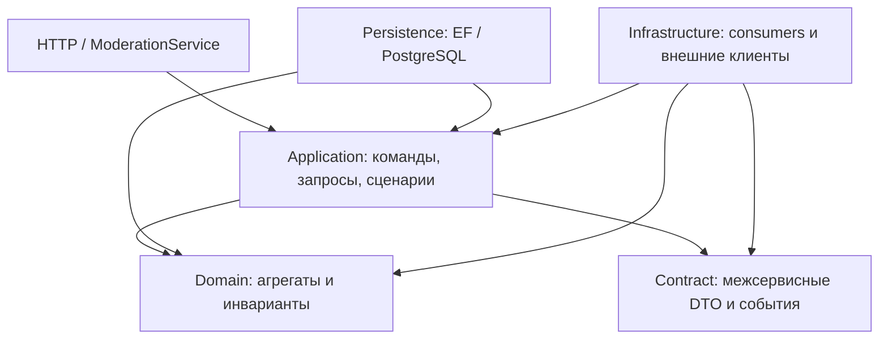

# ModerationService: архитектурный разбор и изменения

Дата: 12 октября 2026. Область: `CoffeePeek.Moderation.*`, `CoffeePeek.ModerationService`,
`CoffeeShop.Moderation.Persistence`, контракты и обработчики меню в Shops.

Перенос на актуальный main выполнен поверх `d69534bc`: сохранены новые Telegram-уведомления,
проверка `ExpectedInputRevision`, persisted OCR jobs и quarantine небезопасных legacy-сообщений.
Результат OCR черновика изменяет только черновик. Автоматическое применение его к live-меню
из первоначальной версии рефакторинга исключено: оно обходило бы принятую в main проверку ревизий.

Сервис сохраняет существующую layered DDD/CQRS архитектуру. Основные найденные проблемы
касались корректности переходов состояния, асинхронного обмена и транзакций, а не недостатка
абстракций. Новые библиотеки, базовые обработчики и дополнительные микросервисы не потребовались.

## Исправленные проблемы

| Приоритет | Проблема и последствие | Изменение |
|---|---|---|
| Высокий | `DecideImportDuplicateHandler` перехватывал доменную ошибку после изменения кандидатов и возвращал обычный ответ. Автотранзакция Wolverine могла сохранить частично выполненное решение. | Уже принятое решение проверяется до загрузки кандидатов; поздняя доменная ошибка выходит из обработчика и откатывает транзакцию. |
| Высокий | У решения о дубликате отсутствовал concurrency token: два модератора могли принять несовместимые решения. | Добавлен PostgreSQL `xmin` и миграция модели. |
| Высокий | Запоздавшее распознавание меню перезаписывало ручное исправление либо более новый запрос. | Каждая попытка получает `ParseRequestId`; принимается только текущий результат в состоянии Pending. Ручное изменение инвалидирует попытку, повтор результата игнорируется. |
| Высокий | Запись результата OCR черновика в опубликованное меню могла бы обойти ревизию. | Сохранён актуальный протокол main: draft consumer не записывает live-меню, ручная публикация требует наблюдаемую `ExpectedInputRevision`; опубликованный OCR работает через persisted job. |
| Средний | Повтор подтверждения публикации создавал лишнюю запись; несовместимая привязка могла заменить опубликованный ID. | Повторная привязка того же ID — no-op; конфликтующий ID отклоняется доменом. Поздний OCR остаётся в черновике и переносится в live-меню только отдельным действием с актуальной ревизией. |
| Высокий | Изменения заявки во время публикации терялись: исходный снимок уже отправлен, а ID каталога ещё неизвестен. | После одобрения основные поля заявки защищены доменом; изменение меню блокируется до получения ID каталога. После привязки меню по-прежнему можно редактировать. |
| Средний | Повторный парсинг черновика перезаписывал ранее введённые вручную цены. | Черновик сохраняет ручные значения. Правила опубликованного меню и защита ручных правок в Shops сохранены из main. |
| Средний | Публичные сеттеры и изменяемые коллекции `MenuDraft` позволяли обойти инварианты. | Закрыты сеттеры, коллекции доступны только для чтения, элементы неизменяемы после создания. Изменения проходят через методы модели. |
| Средний | Некорректная вторая часть изменения могла оставить первую часть применённой. | Валидация названия/описания/enum, контактов импорта, расписания и ручных позиций выполняется до изменения соответствующего состояния. |
| Средний | После повторного одобрения сохранялась причина предыдущего отказа; повтор отказа создавал ещё одну запись аудита. | Одобрение очищает причину; одинаковый нормализованный отказ является no-op и не дублирует аудит. |
| Средний | Не проверялись отдельные enum, координаты, пустые связанные ID, метаданные фотографий, структура расписания. | Проверки перенесены в доменные методы, действуют независимо от HTTP-валидации. |
| Средний | Лишние фотографии меню молча отбрасывались; цены отсутствующих позиций и дубликаты slug давали противоречивые данные. | Превышение лимита отклоняет пакет целиком; цена Absent/Unknown очищается; slug сопоставляется без учёта регистра и крайних пробелов. |
| Средний | Обновление адреса выполняло внешний HTTP-вызов внутри команды записи. Отклонённая заявка не проходила асинхронную повторную проверку адреса. | Используется существующее durable-сообщение геокодирования; SQL-проверка допускает неопубликованные заявки, сверяет текущий адрес и статус перед записью результата. |
| Средний | Для обжарщика можно было передать только город или только адрес и незаметно потерять часть данных. | Неполная пара отклоняется до внешнего поиска и сохранения. |
| Средний | Перехват таймаута внешнего сервиса мог поглотить отмену самой операции. | В соответствующих catch-фильтрах отмена вызывающей стороны больше не преобразуется в обычный результат. |
| Средний | Domain содержал парсер входного файла, SQL-специфичное экранирование и read-порты административных запросов. | Парсер и read-порты/проекции перенесены в Application, ILIKE-экранирование — в Persistence; зависимости потребителей и тесты обновлены. |
| Средний | Сортировка страниц по неуникальному значению давала нестабильный порядок строк с равными датами/оценками. | Добавлен окончательный порядок по ID. Это стабилизирует равные значения, но не превращает offset-пагинацию в snapshot/cursor-пагинацию. |
| Средний | Тест статических обработчиков Wolverine принимал почти любую ошибку старта за успех; Service.Tests отсутствовал в CI-фильтре. | Допускается только ожидаемая ошибка недоступного PostgreSQL после проверки generated handlers; тестовый проект включён в CI. |
| Низкий | Несколько команд, DTO и обработчиков находились в одном файле, а неиспользуемый `Domain.Result` дублировал общие ответы. | Типы разделены по правилу AGENTS.md, лишние импорты и мёртвый код удалены; пространства имён и существующие имена сообщений сохранены. |

## Границы ответственности



- **DDD:** заявка на модерацию и опубликованная кофейня остаются разными моделями и владельцами
  данных. Домен контролирует допустимость изменений; завершение публикации связывает модели
  через событие, без чтения чужой БД.
- **SRP / DIP / ISP:** сценарии зависят от требуемых портов, инфраструктура реализует их;
  административные read-модели не определяют модель домена. Границы сборок закреплены тестами.
- **KISS / DRY:** сохранены Wolverine, существующие репозитории, outbox и сервис применения меню.
  Повторное геокодирование использует уже существующий сценарий; универсальный workflow engine
  или иерархия базовых обработчиков не добавлялись.
- `SaveChangesAsync` внутри обработчика не заменяет транзакционную границу. Она остаётся у
  Wolverine; возвращаемые сообщения передаются через его существующий outbox/cascading pipeline.

Фактическая версия Wolverine в репозитории — 6.35.0. Поведение автосохранения сверено с
[документацией EF-интеграции](https://github.com/jasperfx/wolverine/blob/main/src/Persistence/Wolverine.EntityFrameworkCore/INTERNALS.md).
Статические обработчики Moderation перегенерированы после изменения сигнатур.

## Совместимость и выкладка

1. Сначала обновить **Shops** и дождаться замены старых экземпляров consumers.
2. Применить миграцию Moderation `20261012071955_HardenModerationConsistency` штатным способом.
3. Затем обновить **Moderation**.

`ParseRequestId` — дополнительное необязательное поле событий.
Новый Shops понимает старые сообщения без корреляции. Старый Shops не возвращает correlation ID,
поэтому при обратном порядке rolling deployment новые попытки могут остаться Pending.
Поля `JobId`, `MenuRevision`, `PhotoSetHash` и `ExpectedInputRevision` из main сохранены.
При откате сначала остановить генерацию новых запросов Moderation и обработать/разобрать
оставшиеся новые сообщения, затем откатывать Shops.

Новый `ParseRequestId` хранится в существующем JSON меню. Старые документы без него читаются;
legacy-результат с пустым ID принимается только для legacy Pending-черновика. Новая попытка
или ручная правка прекращает совместимость такого черновика с запоздавшим legacy-результатом.

SQL миграции проверен: Npgsql использует существующий системный `xmin`, поэтому для этой
миграции провайдер генерирует запись в истории миграций без изменения пользовательских таблиц.
Удаления или перезаписи данных миграция не содержит. К реальной БД миграция не применялась.

Существующий `ModerationShopDto.PriceRange` остаётся non-nullable: legacy-значение `0` на границе
команды означает «не изменять/не задано» и не попадает в домен как некорректный enum.
Новые проверки возвращают ошибку для некорректных данных вместо прежнего частичного сохранения
или молчаливого усечения. После одобрения поля заявки следует менять через предусмотренный
сценарий изменения опубликованной сущности.

## Ограничения, которые остаются

Проблема порядка полных снимков уже закрыта в актуальном main через проверку
`ExpectedInputRevision`; этот рефакторинг её сохраняет. См. [протокол меню](../adr/shops-moderation-menu-change.md).
Следующие пункты остаются и не должны считаться обеспеченными гарантиями.

| Приоритет | Ограничение | Следующее решение |
|---|---|---|
| Средний | Проверка дубликата заявки `Any → Insert` не является атомарной. Поиск обжарщика проверяет каталог через HTTP, при недоступности допускает заявку и не защищает очередь pending. | Уточнить бизнес-ключ: название/адрес/город и нормализацию. Перед уникальным ограничением проверить и обработать существующие дубликаты; отдельно решить, допустим ли приём заявки при недоступности каталога. |
| Средний | Обновления OSM/Google остаются синхронными сценариями; задержка внешнего сервиса удерживает запрос, а для чтения Google — и загруженный агрегат. | При требованиях к массовому импорту или короткому HTTP timeout перевести их в job-сценарий по существующему примеру геокодирования. |
| Средний | HTTP DTO используется также как вход для редактирования; null/отсутствие поля не везде различаются. Аудит не охватывает одинаково все операции импорта и жалоб. | Версионированные команды редактирования с явной семантикой очистки; перечень обязательных бизнес-событий аудита. |

Переименование исторических `CoffeeShop.Moderation.Persistence` и `CoffePeek.*` не выполнялось:
AGENTS.md явно принимает эти имена. Общее переписывание Shops, Account, Gateway и deployment
в этот рефакторинг не входит. Параллельные изменения в рабочей копии сохранены.

## Проверки

Основная команда проверки:

```text
dotnet test CoffeePeek.Backend.ci.slnf -c Debug --no-restore -m:1 -p:UseSharedCompilation=false
dotnet list CoffeePeek.Backend.ci.slnf package --vulnerable --include-transitive --no-restore
```

После переноса на актуальный main прогон завершился успешно: **2150 тестов прошли, 183 пропущены, ошибок нет**.
Из них Moderation: Application — 57, Domain — 193, Service — 79, все прошли.
Пропуски относятся к существующим интеграционным/live-тестам Account, Shops и миграции legacy.
Сборка сохраняет существующие предупреждения nullable/XML-документации и анализаторов тестов;
они не подавлялись общей настройкой. `git diff --check` проходит.

Регрессионные тесты покрывают переходы статусов, атомарность изменений, повторные решения,
гонки парсинга и публикации, приоритет ручных цен, асинхронное геокодирование, границы сборок,
EF concurrency mapping, совпадение модели с миграцией и наличие статических Wolverine handlers.
Проверка уязвимостей NuGet не обнаружила уязвимых пакетов по доступным источникам.

Тесты репозиториев с EF InMemory подтверждают сценарии приложения, но не заменяют проверку
блокировок, JSON mapping и outbox на реальном PostgreSQL. Полный E2E через RabbitMQ,
PostgreSQL, MinIO, внешние геосервисы и Gateway в этой сессии не запускался:
Docker CLI установлен, но Docker Desktop Linux Engine недоступен.
