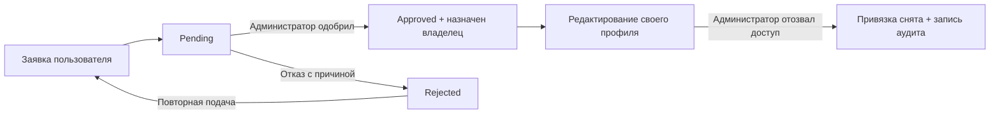

# Владение кофейнями и обжарщиками: план реализации

Дата: 28 октября 2026 года. Статус: backend реализован; локальная проверка завершения описана в разделе 11. Контракты для клиента: [business-ownership-api.md](business-ownership-api.md).

## 1. Цель и границы первой версии

Авторизованный пользователь подаёт заявку на управление существующей кофейней или обжарщиком. Администратор проверяет полномочия и принимает решение. После одобрения пользователь видит бизнес в своём кабинете и может редактировать его профиль.

**Подтверждено пользователем:**

- Полномочия выдаются после одобрения заявки администратором.
- Правки подтверждённого владельца публикуются сразу после сохранения.
- Первая версия включает профиль, контакты, расписание и фотографии. Расписание относится к кофейням: у обжарщиков такого поля сейчас нет.

**Рабочие решения этого плана:**

- Один основной владелец на бизнес; один пользователь может владеть несколькими кофейнями и обжарщиками.
- Заявка содержит контакт для связи и текстовое подтверждение полномочий, в том числе ссылки. Администратор проверяет их вручную. Загрузку документов и автоматическую проверку домена в первую версию не включаем.
- Заявитель видит свои заявки и решения; администратор — общую очередь, детали и историю назначения владельцев.
- Администратор может отозвать доступ с указанием причины.
- Заявка на уже принадлежащий кому-то бизнес не используется для передачи владения. Спор решается администратором через отзыв текущего доступа и последующее рассмотрение новой заявки.
- Реализуется backend API. Экран подачи заявки, кабинет и административный интерфейс подключаются в клиентском проекте.

| Кофейня | Обжарщик |
| --- | --- |
| Название, описание | Название, описание |
| Телефон, email, сайт, Instagram | Сайт, Instagram — существующие поля контактов |
| Город, адрес, расположение | Город, адрес, расположение |
| Расписание по существующему контракту | — |
| Галерея и порядок фотографий | Галерея и порядок фотографий |

Существующие возможности владельца кофейни по выбору оборудования, зёрен, обжарщиков и способов приготовления сохраняются. Управление меню, ценами, товарами обжарщиков, сотрудниками, пользовательскими отзывами, классификацией и публичными slug в объём новой функции не входит. Уведомления, передача владения между пользователями и история всех изменений контента — следующие этапы; статус заявки в первой версии доступен через API.

## 2. Основание в текущем коде

| Уже существует | Как используем |
| --- | --- |
| `CoffeeShop.OwnerUserId`, индекс владельца и `AssignOwner` | Сохраняем как источник текущего доступа к кофейне |
| `OwnerCoffeeShopsController`, `Features/Owner`, запросы репозиториев с фильтром по владельцу | Используем существующие чтение и редактирование кофеен |
| `PATCH /api/admin/shops/{id}/owner`, `AssignCoffeeShopOwnerHandler` | Сохраняем совместимость; включаем назначение и снятие владельца в общий аудит |
| `AdminRoastersController`, `UpdateRoasterHandler`, `RoasterProfileFields` | Повторно используем проверку полей и работу с фотографиями для owner API |
| `IPublicAddressService.ResolveAsync` | Принимаем публичный slug в заявке и сохраняем разрешённый внутренний ID |
| Общая `CoffeeShop.ProfileRevision`, `If-Match`, обработка EF-конфликтов | Сохраняем защиту правок кофеен; назначение и отзыв тоже увеличивают ревизию |
| Media presign, `TrustedUploadedShopPhotos`, `ShopPhotosAttachedEvent` | Сохраняем проверку загруженных файлов, их Media ID, URL и привязку к автору |
| Wolverine, `ShopsDbContext`, PostgreSQL outbox | Фиксируем решение, владельца, аудит и сообщения в одной локальной транзакции |

Ключевые исходники:

- [OwnerCoffeeShopsController](../CoffeePeek.ShopsService/Controllers/OwnerCoffeeShopsController.cs), [UpdateOwnerCoffeeShopHandler](../CoffeePeek.Shops.Application/Features/Owner/UpdateOwnerCoffeeShopHandler.cs).
- [Назначение владельца кофейни](../CoffeePeek.Shops.Application/Features/Admin/Shops/AssignCoffeeShopOwnerHandler.cs).
- [AdminRoastersController](../CoffeePeek.ShopsService/Controllers/AdminRoastersController.cs), [UpdateRoasterHandler](../CoffeePeek.Shops.Application/Features/Admin/Catalogs/Roasters/UpdateRoasterHandler.cs), [RoasterProfileFields](../CoffeePeek.Shops.Application/Features/Admin/Catalogs/Roasters/RoasterProfileFields.cs).
- [ShopsDbContext](../CoffeePeek.Shops.Persistance/Configuration/ShopsDbContext.cs), [WolverineModule](../CoffeePeek.Shared.Persistence/Extensions/WolverineModule.cs).
- [Границы модулей](shops-module-ownership.md), [решения по профилю](shops-architecture-decisions.md), [граница фотографий](shops-community-photo-transition.md).

В рабочем дереве уже есть изменения по другим задачам, включая Gateway, DI, миграции и контрактные тесты. При реализации работать поверх актуальных файлов, не откатывать их и не включать посторонние изменения в коммиты функции.

## 3. Размещение и авторизация

Заявки и журнал изменения доступа размещаем в БД Shops. Это операции управления опубликованными бизнесами: решение и назначение владельца должны коммититься вместе. Перенос заявки в отдельную БД Moderation потребовал бы промежуточного состояния и доставки прав через очередь; для первой версии такой процесс не нужен.

Внутри ShopsService:

- Модуль Shops владеет заявками, журналом доступа и изменением `CoffeeShop.OwnerUserId`.
- CoffeeCatalog владеет `Roaster.OwnerUserId` и редактированием профиля обжарщика.
- Обработчик решения вызывает узкий порт CoffeeCatalog для назначения владельца обжарщика. Прямую запись чужого агрегата из модуля Shops не добавлять.
- Все адаптеры используют один scoped `ShopsDbContext`. Вложенный вызов через `IMessageBus.InvokeAsync` не должен создавать отдельную транзакцию назначения.
- `PublicAddresses` разрешает slug, а Discovery продолжает только читать исходные профили.

Право редактирования определяется сравнением текущего пользователя с `OwnerUserId` конкретного объекта. Одобренная заявка — историческое решение, а не самостоятельное вечное разрешение на запись.

Изменения авторизации:

1. Для `/api/owner/{**remainder}` в Gateway выбрать существующую policy `Authenticated`.
2. В owner-контроллерах Shops применять аутентификацию и обязательный фильтр владельца в каждом чтении/изменении. Проверить также фотографии и `ShopPrimaryEquipmentController`.
3. Глобальные роли `Owner`/`Roaster` не переопределять и не назначать пользователю при одобрении. Доступ начинает действовать со следующим запросом с тем же JWT.
4. Заявитель и администратор-исполнитель берутся только из доверенного `IUserContext`; клиент не задаёт их в теле запроса.
5. Решения, назначение и отзыв доступны только `Admin`. У `AdminRoastersController` сейчас policy `Moderator`: новый метод изменения владельца должен отдельно требовать `Admin`.
6. Чужие owner-объекты и заявки возвращают `404`; административные операции без роли — `403`; без аутентификации — `401`.

## 4. Модель данных и жизненный цикл

### Заявка `BusinessOwnershipClaim`

| Поля | Назначение |
| --- | --- |
| `Id`, `BusinessType`, `BusinessId` | ID заявки; тип `CoffeeShop`/`Roaster`; стабильная ссылка на бизнес |
| `BusinessNameSnapshot`, `BusinessSlugSnapshot` | Контекст заявки, сохраняющийся при переименовании или удалении бизнеса |
| `ApplicantUserId` | Пользователь из аутентифицированного запроса |
| `Contact`, `Evidence` | Обязательные контакт и описание подтверждения; предлагаемые пределы 320 и 4000 символов после trim |
| `Status`, `CreatedAtUtc` | `Pending`, `Approved`, `Rejected`; время создания |
| `ReviewedByUserId`, `ReviewedAtUtc`, `DecisionReason` | Результат проверки; причина обязательна при отказе, максимум 2000 символов |
| `Revision` | EF concurrency token для конкурирующих решений |

Ограничения БД: допустимые типы/статусы, согласованность полей решения, уникальная ожидающая заявка на `(BusinessType, BusinessId, ApplicantUserId)` с фильтром `Status = Pending`. Индексы для собственной истории и административной очереди по статусу, дате и ID. Не делать уникальным только `BusinessId`: на один бизнес могут претендовать разные пользователи.

Полиморфная ссылка на две таблицы проверяется приложением. Удаление бизнеса не удаляет заявку или аудит; одобрение заявки на удалённую запись возвращает `404`.

### Текущий доступ и журнал

- Кофейни продолжают хранить `OwnerUserId` и `ProfileRevision` в существующей таблице.
- В `Roasters` добавить nullable `OwnerUserId` с индексом и `ProfileRevision` со значением по умолчанию `0`, помеченную EF concurrency token.
- `BusinessOwnershipChanges` хранит `Id`, тип/ID бизнеса, прежнего/нового владельца, исполнителя, время, причину и необязательный `ClaimId`. Таблица дополняется при одобрении, ручном назначении и отзыве, без переписывания старых записей.
- Существующие назначения кофеен сохраняются. Исторические действия и администраторов для них не выдумывать; аудит начинается с включения функции.
- Отзыв очищает текущего владельца и пишет аудит. Исходная заявка остаётся `Approved`, поскольку это факт ранее принятого решения. В ответах кабинета отдельно показывать `HasCurrentAccess`, вычисленный по текущей привязке.

### Переходы



Правила обработки:

- Подача разрешена для существующего доступного публично бизнеса без владельца. Неверный тип, пустые поля и превышение длины — `400`; неизвестный/скрытый бизнес — `404`; уже назначенный владелец или собственная ожидающая заявка — `409`.
- Slug разрешается через существующий `IPublicAddressService`, включая поддерживаемые им адресные правила. После подачи используется сохранённый ID: смена slug не меняет объект заявки.
- Одобрять можно только `Pending`. Перед записью повторно проверить наличие бизнеса и отсутствие владельца, затем в одной транзакции изменить владельца, ревизию, заявку и аудит.
- Повтор того же решения возвращает уже сохранённый результат без новых записей аудита. Противоположное решение по закрытой заявке — `409`. Повтор старого approval после отзыва доступа никогда не восстанавливает привязку.
- Остальные заявки на бизнес остаются на рассмотрении; повторное одобрение для другого пользователя получает `409`. Администратор может отклонить их с причиной.
- Отклонение не меняет бизнес. Повторная подача после отказа создаёт новую заявку и сохраняет предыдущую историю.
- Администратор может отозвать доступ и у владельца, назначенного до появления заявок.

## 5. Предлагаемые HTTP-контракты

Маршруты идут через Gateway. Новые операции возвращают существующий envelope `Response<T>`; ошибки интегрируются с текущим `ErrorResponse`/exception handling.

| Метод и маршрут | Доступ | Назначение |
| --- | --- | --- |
| `POST /api/owner/ownership-claims` | Авторизованный пользователь | Подать заявку по `businessType`, `businessSlug`, `contact`, `evidence`; `201` + заявка и `Location` |
| `GET /api/owner/ownership-claims` | Авторизованный пользователь | Только собственные заявки, фильтр статуса и пагинация |
| `GET /api/owner/ownership-claims/{id}` | Заявитель | Своя заявка, решение и текущий доступ |
| `GET /api/admin/ownership-claims` | Admin | Очередь; фильтры статуса, типа, business ID и пагинация; по умолчанию `Pending` |
| `GET /api/admin/ownership-claims/{id}` | Admin | Детали заявки и текущий владелец бизнеса |
| `POST /api/admin/ownership-claims/{id}/approve` | Admin | Одобрение; необязательный комментарий |
| `POST /api/admin/ownership-claims/{id}/reject` | Admin | Отказ с обязательной причиной |
| `GET /api/admin/ownership-changes` | Admin | История доступа с фильтром типа/business ID и пагинацией |
| `GET /api/owner/coffee-shops[/{id}]` | Владелец записи | Существующие список и детали кофеен |
| `PUT /api/owner/coffee-shops/{id}` | Владелец записи | Существующее обновление профиля и `If-Match` |
| Существующие `/api/owner/coffee-shops/{id}/photos` и `/photos/order` | Владелец записи | Добавление, удаление и порядок фотографий |
| `GET /api/owner/roasters[/{id}]` | Владелец записи | Новые список и редактируемые детали обжарщиков |
| `PUT /api/owner/roasters/{id}` | Владелец записи | Сохранить профиль, контакты, расположение и галерею |
| `PATCH /api/admin/shops/{id}/owner` | Admin | Существующее назначение/снятие; `ownerUserId: null` снимает доступ |
| `PATCH /api/admin/roasters/{id}/owner` | Admin | Аналогичное административное назначение/снятие |

У новых списков `page=1`, `pageSize=20`, максимальный `pageSize=100`; стабильная сортировка по дате и ID, `totalCount` в ответе. Параметры проверяются на переполнение. Существующий список кофеен не менять несовместимо.

Тело заявки, например:

```json
{
  "businessType": "CoffeeShop",
  "businessSlug": "example-coffee",
  "contact": "manager@example.com",
  "evidence": "Управляю этой кофейней. Могу подтвердить доступ через официальную почту."
}
```

Владелец получает внутренние ID только для принадлежащих ему объектов через кабинет/свою одобренную заявку. Для выбора бизнеса используются существующие публичные страницы со slug; клиенту не нужен доступ к административным справочникам.

В административное назначение добавить необязательную причину совместимо с текущим телом запроса. Для нового roaster endpoint причина отзыва обязательна; для старого shop endpoint отсутствие причины сохраняет совместимость и фиксируется явным служебным значением. Новый административный клиент всегда отправляет причину. Передача `actorUserId` от клиента запрещена.

Gateway должен явно направлять `/api/admin/ownership-claims/{**remainder}` и `/api/admin/ownership-changes/{**remainder}` в Shops: общий `/api/admin/{**remainder}` сейчас ведёт в Account. Для POST подачи использовать существующую `moderation-submission` policy отдельным маршрутом, чтобы не ограничивать ею все owner-операции.

## 6. Целостность, конкуренция и фотографии

### Атомарность

- Решение по заявке и получение доступа — один Wolverine handler и одна транзакция `ShopsDbContext`; проверяем сгенерированный код, а не только DI-регистрацию.
- Уникальный индекс закрывает гонку двух одинаковых подач. Конкурентное одобрение/отказ защищены `Revision` заявки.
- Конкурирующие одобрения разных заявителей и ручное назначение защищены concurrency token профиля. Победитель один; проигравшая транзакция возвращает `409` и не оставляет одобренной заявки без доступа.
- Назначение, отзыв и правки кофеен увеличивают общую `ProfileRevision` ровно один раз на реальное изменение. Для обжарщиков применять такую же общую ревизию к admin/owner-правкам, фотографиям и изменению владельца.
- Для нового owner PUT обжарщика требовать `If-Match`; отсутствие — `428`, неверный формат — `400`, устаревшая версия — `409`. GET и успешный PUT возвращают `ProfileRevision`. Существующий admin PATCH получает необязательный `If-Match`, сохраняя прежних клиентов.
- EF-конфликты профиля и решения переводятся в неретрабельный `409` до общей Wolverine retry-policy, как уже сделано для кофеен. Запоздалая правка не должна автоматически перечитывать и перезаписывать новую версию.
- Отзыв действует с коммита. Запрос, начавшийся раньше отзыва, но коммитящийся позже, должен получить конфликт или отказ в доступе. Правка, закоммиченная раньше отзыва, остаётся корректной.

### Профили и фото

- Повторно использовать `RoasterProfileFields` и общую логику admin-обновления, добавив обязательную проверку владельца для owner-команды до вызова Media и изменения агрегата. Не копировать реализацию редактирования в новый контроллер.
- Для owner PUT явно описать семантику: профиль сохраняется целиком; `photos: null` сохраняет галерею, `photos: []` очищает, массив задаёт полный состав и порядок. Не переинтерпретировать существующий admin PATCH в рамках этой функции.
- Проверки полей и ссылок на город выполняются до изменения. Обработку отсутствующего города и EF FK сохранить в существующем контракте ошибок.
- Фото, уже находящиеся в галерее, сохраняют Media ID и metadata, включая добавленные предыдущим владельцем или администратором. Новые загрузки проверяются относительно текущего пользователя.
- Владение бизнесом не даёт доступа к чужим загрузкам или редактированию `CheckInPhotos`/отзывов. Галерея профиля остаётся отдельной от Community.
- Сохранять outbox-события прикрепления фото и инвалидации кеша. При откате в БД не публиковать успешное прикрепление; временные Media claims обрабатываются существующим механизмом восстановления.

### Данные заявителя

- Contact/evidence доступны только заявителю и Admin, не попадают в публичные карточки и обычные логи. Ссылки в evidence не скачиваются сервером.
- Для подтверждения существования заявителя перед выдачей доступа использовать существующий `IUserExistenceLookup`. Его `false` сейчас означает и отсутствие аккаунта, и сбой Account: не выдавать права, не отклонять заявку автоматически; вернуть нейтральный `409` о невозможности подтвердить аккаунт и оставить `Pending`.
- Эта проверка не доказывает принадлежность бизнеса и не заменяет ручное решение. Автоматическое снятие привязок при последующем удалении аккаунта требует отдельного события Account и не входит в первую версию; администратор может снять такую привязку вручную.

## 7. Последовательность реализации

Каждый этап должен завершаться проверяемым результатом. Частично готовую функцию не выкладывать пользователям до этапа 6.

### Этап 1. Доменные правила и хранение

- [ ] Добавить типы заявки, статусов, типа бизнеса и записи аудита; один верхнеуровневый тип на C# файл.
- [ ] Добавить владельца и ревизию обжарщика, конфигурации EF, индексы и additive migration с designer/snapshot.
- [ ] Сохранить существующих владельцев кофеен, slug, профили и фотографии. Для старых обжарщиков владелец `null`.
- [ ] Внести новые таблицы в `docs/shops-module-ownership.md` и `Architecture/TableOwnershipTests.cs`.
- [ ] Проверить миграцию на свежей БД и на БД с существующими владельцами/фото; исторические миграции сохраняются.

Результат: доменные тесты переходов и валидации проходят; схема хранит заявки и текущий доступ без потери старых данных.

### Этап 2. Заявки пользователя и очередь администратора

- [ ] Реализовать подачу, собственный список/детали, административный список/детали и DTO с серверными идентификаторами исполнителей.
- [ ] Разрешать slug через `IPublicAddressService`; проверять видимость и существование бизнеса, владельца и дубли ожидающих заявок.
- [ ] Добавить ограниченную пагинацию, фильтры и HTTP mapping ошибок.
- [ ] Добавить Gateway-маршруты и throttling подачи.

Результат: пользователь отправляет заявку через Gateway, видит свою историю; администратор видит её в очереди; права редактирования ещё не выдаются подачей.

### Этап 3. Одобрение, отказ, отзыв и аудит

- [ ] Реализовать команды решения и узкие порты назначения владельца для Shops/CoffeeCatalog.
- [ ] Связать запись решения, владельца, ревизии, аудита и outbox одной транзакцией; закрыть гонки и повторные запросы.
- [ ] Провести существующий `AssignCoffeeShopOwnerHandler` через тот же путь назначения/аудита, передав доверенного исполнителя из контроллера.
- [ ] Добавить административное назначение/отзыв обжарщика и чтение журнала изменений доступа.
- [ ] Подтвердить, что повтор approval после отзыва не возвращает права.

Результат: административное решение либо полностью выдаёт доступ и записывает историю, либо не меняет ничего.

### Этап 4. Кабинет и редактирование

- [ ] Перевести только owner HTTP-маршруты с обязательной JWT-роли на аутентификацию плюс проверку текущего владения.
- [ ] Проверить все существующие owner-операции кофеен: чтение, профиль, основное оборудование, добавление/удаление/порядок фото.
- [ ] Добавить список, детали и PUT обжарщиков с фильтром владельца и общей логикой admin/owner-редактирования.
- [ ] Добавить ревизию в административные/owner-контракты обжарщика и `If-Match`; сохранить публичные DTO без контактных данных заявителя и owner ID.
- [ ] Проверить, что одобрение и отзыв работают с прежним JWT без смены глобальной роли и повторного входа.

Результат: подтверждённый владелец редактирует свой бизнес; остальные пользователи не получают доступ по подбору UUID или подмене тела запроса.

### Этап 5. Генерация, тесты и документация

- [ ] Перегенерировать Wolverine handlers в ShopsService после добавления команд/изменения сигнатур; изменения генерации включить в итоговый коммит функции.
- [ ] Прогнать доменные, application, HTTP, архитектурные и PostgreSQL-тесты из матрицы ниже.
- [ ] Обновить OpenAPI/Scalar, примеры JSON, описание owner/admin API и README.
- [ ] Добавить smoke-сценарий через Gateway по существующим dev-паттернам и включить новые live-тесты в соответствующий CI gate.

Результат: production static-codegen видит новые обработчики; клиентский разработчик имеет маршруты, тела запросов, ревизии и примеры ошибок.

### Этап 6. Проверка выпуска

- [ ] Выполнить полные проверки репозитория; отдельно записать результаты обязательных live-тестов.
- [ ] Применить миграцию до запуска новой версии сервисов штатным deployment-путём.
- [ ] Развернуть Shops и Gateway согласованно; проверить полный сценарий и отзыв доступа через Gateway.
- [ ] Для отката сохранить таблицы заявок/аудита и новые колонки. Возврат старого Gateway/host снова потребует роль `Owner`, поэтому доступ новых владельцев при таком откате может временно пропасть.

Результат: сквозной сценарий работает на конфигурации, соответствующей production; выпуск производится отдельным действием после реализации.

## 8. Карта затронутого кода

| Область | Планируемые изменения |
| --- | --- |
| `CoffeePeek.Shops.Domain` | Заявка/аудит; владелец и ревизия `Roaster`; доменные правила |
| `CoffeePeek.Shops.Application/Features/Ownership` (новая) | Подача, чтение, решения, общий процесс выдачи/отзыва доступа |
| `CoffeePeek.Shops.Application/Features/CoffeeCatalog` | Порт и реализация владения обжарщиком, owner-запросы/редактирование |
| `Features/Owner`, `Features/Admin/Shops`, `Features/Admin/Catalogs/Roasters` | Повторное использование существующих операций; аудит, actor, общая ревизия |
| `CoffeePeek.Shops.Application/PublicAddresses` | Использование существующего resolver; новый registry не нужен |
| `CoffeePeek.Shops.Persistance` | Репозитории, EF-конфигурации, модули DI, обработка конфликтов, миграция/snapshot |
| `CoffeePeek.ShopsService/Controllers` | Новые claims/admin/owner-roaster endpoints; адресная смена авторизации старых owner endpoints |
| `CoffeePeek.ShopsService/InfrastructureExtensions.cs` | При необходимости регистрация новых портов для Wolverine service location |
| `CoffeePeek.ShopsService/Internal/Generated/WolverineHandlers` | Генерация и проверка транзакций новых/изменённых команд |
| `CoffeePeek.Contract` | DTO запросов/ответов и ревизий по текущим соглашениям; не возвращать Domain entity напрямую |
| `CoffeePeek.Gateway/appsettings.json` | Маршруты claims/audit, Authenticated для owner, rate-limit подачи |
| Shops Domain/Application/Infrastructure/Service tests, Gateway tests | Правила, изоляция доступа, маршрутизация, транзакции и конкуренция |
| `docs`, `dev`, `.github/workflows/ci-cd.yml` | Контракты, smoke и включение live-проверок |

При изменении bundled C# файлов разделить их типы с сохранением namespace/контрактов. Уже обнаружены такие случаи: `AdminRoastersController.cs` содержит `UpdateRoasterRequest`, `QueryRoasterRepository.cs` — также `RoasterRepository`, `Controllers/Admin/AdminCoffeeShopRequests.cs` — несколько request-типов.

## 9. Проверки и критерии готовности

| Уровень | Обязательные сценарии |
| --- | --- |
| Domain/Application | Пустые/слишком длинные contact/evidence; неизвестные enum; повтор pending; заявка на занятый/скрытый/удалённый бизнес; approve/reject и повторы; сохранение истории; отзыв старого назначения |
| Application | Чужой и непривязанный пользователь не меняют профиль и не вызывают Media; собственный может менять; ошибка Account не выдаёт права и не закрывает заявку |
| HTTP/Gateway | Обычный `User` подаёт заявку; без JWT `401`; User/Moderator не принимают решения; чужая заявка `404`; нельзя подменить заявителя/исполнителя; admin claims попадают в Shops, не Account |
| Owner HTTP | Тот же JWT работает сразу после approval; после revoke запись исчезает из списка и недоступна; чужие фото и профили недоступны; оба типа бизнеса проходят одинаковый путь |
| EF/PostgreSQL | Две подачи одного заявителя создают одну pending; approve/approve и approve/reject одной заявки; разные заявители одновременно; решение против ручного назначения/отзыва; ровно один владелец, корректные статус и аудит |
| EF/PostgreSQL | Искусственный сбой между назначением и сохранением откатывает владельца, решение, аудит и outbox; owner-правка после конкурентного revoke не коммитится; админ/владелец с одной ревизией получают один успех и один `409` |
| Фото | Сохраняются Media ID и старые фото; новые upload keys принадлежат актору; `null`/пустая/полная галерея работают по контракту; отказ Media не частично обновляет профиль; Community-фото недоступны для записи владельцу бизнеса |
| Миграции | Свежая установка и upgrade с существующими владельцами/профилями/фото; модель соответствует snapshot; новые ограничения работают на реальном PostgreSQL |
| Архитектура/production | TableOwnership и CrossModuleWrite tests; полный OpenAPI генерируется; каждый новый handler имеет pre-generated adapter и нужную транзакцию |

Для PostgreSQL гонок использовать существующие fixtures из `ShopProfileRevisionLiveTests`, `ShopProfileWolverineLiveTests`, `ShopsDirectWriteBoundaryLiveTests`. InMemory-тесты не считаются доказательством транзакционности или уникальности. Live-тесты не должны тихо пропускаться в обязательном CI gate.

Проверки из корня после реализации:

```text
dotnet restore CoffeePeek.Backend.ci.slnf
dotnet tool restore
dotnet build CoffeePeek.Backend.ci.slnf -c Release
dotnet test CoffeePeek.Backend.ci.slnf -c Debug
dotnet list CoffeePeek.Backend.ci.slnf package --vulnerable --include-transitive
python dev/security/scan_secrets.py scan
```

Генерация: из `CoffeePeek.ShopsService` выполнить `dotnet run -- codegen write` с необходимой конфигурацией согласно `AGENTS.md` и dev helpers; затем повторно собрать и запустить проверки pre-generated handlers. Секреты в команды/документацию не копировать.

**Функция готова**, когда обычный пользователь проходит через Gateway весь путь для обоих типов бизнеса: подача → проверка администратором → одобрение → получение своего профиля → редактирование и публичное чтение результата → отзыв → отказ в следующем редактировании. Конкурирующие запросы, неуспешная транзакция и повтор старого решения не выдают лишних прав и не теряют историю.

## 10. Что проверено при подготовке плана

Прочитаны текущие owner/admin endpoints, записи владельца/профилей, обработка фото, авторизация/маршрутизация Gateway, EF concurrency, Wolverine и существующие тестовые точки. Зафиксированы два продуктовых решения пользователя из раздела 1.

При первоначальной подготовке был изменён только этот документ. После согласования объёма пользователь поручил реализацию нескольким агентам; результат и проверки приведены ниже.

## 11. Реализация и проверка

Реализованы заявки для обоих типов бизнеса, собственная история, административная очередь и решения, аудит назначения/отзыва, доступ по текущему владельцу без смены JWT, кабинет обжарщика и немедленное сохранение профилей. Повтор старого одобрения после отзыва не возвращает доступ. Существующее редактирование кофеен и Media-проверки повторно используются.

Добавлена миграция `20261028141439_AddBusinessOwnershipClaims`, сохранён EF snapshot, обновлены Wolverine pre-generated handlers, Gateway routes и обязательный PostgreSQL gate CI. Миграция не меняет существующие назначения кофеен; откат схемы блокируется при наличии новых заявок, аудита или владельцев обжарщиков, чтобы не потерять права и историю.

Проверки 28 октября 2026 года:

- Полная `CoffeePeek.Backend.ci.slnf` собирается в Release без ошибок.
- Полный `dotnet test CoffeePeek.Backend.ci.slnf -c Debug` на чистой PR-ветке от `develop`: 2705 прошли, 0 упали, 255 пропущены из-за отсутствующих настроек live/fault-окружений. В том числе ShopsService — 213, Gateway — 111; OpenAPI, архитектура, примеры API и pre-generated handlers проходят.
- Реальный PostgreSQL: 14 тестов назначения/отзыва, конкурирующих решений и профилей, уникальности, транзакционной видимости и отката прошли без пропусков. Отдельно проверено обновление старой схемы с сохранением владельца кофейни, ревизии, профилей, Media ID и ключей фотографий; EF-модель соответствует snapshot. Откат с уже созданной заявкой не удаляет историю.
- Через настоящие Gateway, JWT-проверку и Shops с PostgreSQL/Redis/RabbitMQ пройден полный сценарий для кофейни и обжарщика: заявка → одобрение → чтение и запись тем же токеном обычного User → немедленное публичное чтение → отзыв → следующие GET/PUT возвращают 404 → повтор старого approval не возвращает доступ. Использованы отдельные временные БД, Redis и Rabbit vhost; после проверки ресурсы очищены. Проверка существования Account заменена локальной заглушкой только для тестового пользователя, JWT подписаны отдельным тестовым ключом; настоящий вход в Account этим запуском не проверен.
- Python: 3 теста smoke-скрипта и 3 теста discovery/Gateway-контракта прошли. Тест smoke-скрипта добавлен в CI.
- NuGet vulnerability audit и сканирование секретов прошли.

Деплой и применение миграций к production не выполнялись. Клиентские экраны находятся за пределами этого backend-репозитория. Проверка загрузки новых файлов через настоящий Media/MinIO остаётся отдельной проверкой окружения; проверки прав на фото и сохранения существующей галереи покрыты application/HTTP-тестами.
