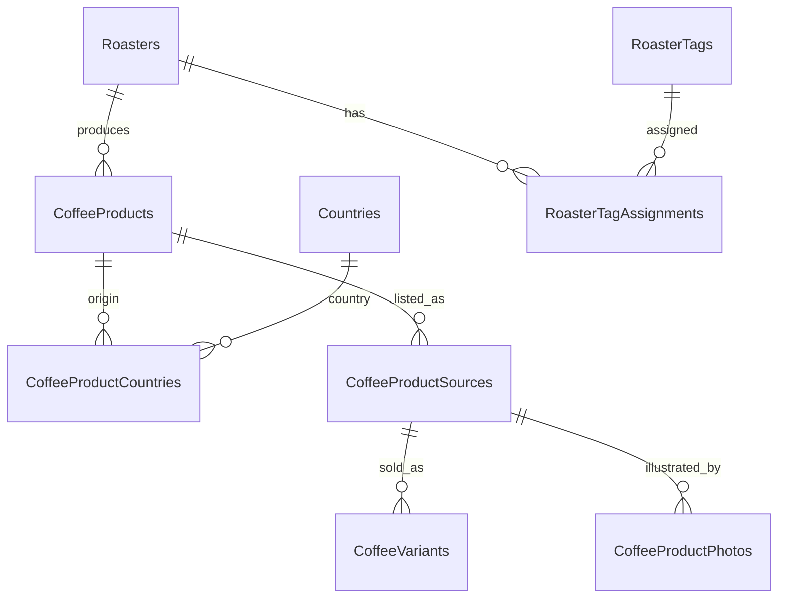
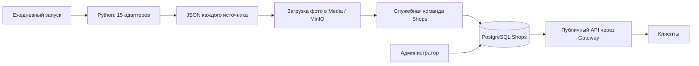

# Каталог кофе обжарщиков: управляемые теги и ежедневный импорт

Архитектура от 5 октября 2026 года, реализована для 15 источников: таблицы и миграция Shops, импорт, фотографии Media/MinIO, управляемые теги и API. Настройка и контракты: [coffee-catalog-api.md](coffee-catalog-api.md). Миграция в рабочую БД и активация VPS ещё не выполнялись. Кандидаты тегов не созданы и не назначены: пользователь сначала выбирает нужные.

## Решения

- Каталог принадлежит существующему Shops Service и его PostgreSQL. Отдельный сервис каталога и очередь между Python и Shops для первой версии не нужны.
- Конкретный кофе — новый `CoffeeProduct`, связанный с существующим `Roaster`. Вес, помол, цена и наличие относятся к варианту покупки у определённого источника.
- Страна выращивания — отдельный `Country` с ISO-кодом. Один продукт может иметь несколько стран; число стран само по себе не определяет, является ли кофе смесью.
- Теги обжарщиков управляются администратором по образцу тегов кофеен. Администратор создаёт, переименовывает, сортирует и деактивирует теги, назначает и снимает их с обжарщиков. Импорт не изменяет эти назначения.
- Источник-продавец и обжарщик разделены. Сова продаёт KOF и Kanga; наличие River из espressoclub.by имеет область `in_store`. Цена магазина не становится общей ценой обжарщика, наличие в витрине не становится наличием во всех его кофейнях.
- Парсер собирает снимки раз в сутки. В пользовательском API читается опубликованный каталог из БД; сайты обжарщиков при открытии страницы пользователем не опрашиваются.

## Что работает сейчас

`dev/coffee-import/import_coffees.py` собирает 15 источников, сохраняет `coffees.json`, CSV и Markdown в отдельный каталог каждого источника, пишет `last-run.json`. При ошибке прежний JSON источника сохраняется, другие источники продолжают обновляться. Сырые HTTP-ответы находятся в `.cache` для воспроизводимой проверки парсеров.

Локальные выгрузки лежат в `dev/imports/<source>/`. Подготовленный systemd service использует серверный каталог `/var/lib/coffeepeek-coffee-import/<source>/`; timer запускает его ежедневно в 03:00 UTC с выполнением пропущенного запуска после старта сервера. Таймер ещё не активирован. С `--push` джоба сохраняет фотографии через Media и применяет снимки через Shops; без этого флага обновляет только файлы.

API дополнен каталогом кофе, тегами и сводкой в профиле обжарщика. Новые карточки требуют публикации администратором. В репозитории нет клиентского приложения: API и DTO готовы для подключения отображения на клиентах.

## Кандидаты управляемых тегов

Это полный предложенный набор из 52 тегов для выбора, основанный на текущих полях и исходных свойствах карточек. Не все признаки извлечены у каждого источника. Перед назначением конкретному обжарщику администратор проверяет подтверждающие товары и формулировки источника. Вкусовые ноты описывают заявленный вкус кофе и сами по себе не означают добавленные ароматизаторы.

| Номера | Группа | Теги |
| --- | --- | --- |
| 1–10 | Приготовление | 1. Для фильтра; 2. Для эспрессо; 3. Для напитков с молоком; 4. Универсальная обжарка; 5. Для турки; 6. Для гейзерной кофеварки; 7. Для аэропресса; 8. Для френч-пресса; 9. Для пуровера и кемекса; 10. Для заваривания в чашке |
| 11–20 | Ассортимент | 11. Есть декаф; 12. Есть лоукаф; 13. Зелёное зерно; 14. 100% арабика; 15. Есть робуста; 16. Смеси с робустой; 17. Моносорта; 18. Купажи; 19. Микролоты; 20. Есть гейша |
| 21–28 | Обработка | 21. Мытая обработка; 22. Натуральная обработка; 23. Хани; 24. Анаэробная обработка; 25. Полуанаэробная обработка; 26. Вет-халл; 27. Выдержка в бочках; 28. Экспериментальная ферментация |
| 29–31 | Обжарка | 29. Светлая; 30. Средняя; 31. Тёмная |
| 32–43 | Вкусовой профиль | 32. Шоколадные ноты; 33. Ореховые ноты; 34. Карамельные ноты; 35. Медовые ноты; 36. Ягодные ноты; 37. Цитрусовые ноты; 38. Тропические фрукты; 39. Цветочные ноты; 40. Чайные ноты; 41. Пряные ноты; 42. Винные ноты; 43. Сухофрукты |
| 44–47 | Кислотность и тело | 44. Низкая кислотность; 45. Яркая кислотность; 46. Плотное тело; 47. Лёгкое тело |
| 48–52 | Покупка | 48. Помол под заказ; 49. Малые фасовки 100–150 г; 50. Фасовки 500 г; 51. Фасовки 1 кг; 52. Фасовки 2 кг |

Назначение «100% арабика», моносорта, микролота или гейши требует прямого указания в источнике. Помол под способ приготовления не доказывает назначение обжарки. Для кислотности и тела учитывать шкалу конкретного сайта; числовые шкалы разных сайтов не считать одинаковыми. Универсальная обжарка подтверждается явно указанным omni/омнирост.

Страны удобнее показывать отдельными фильтрами со своими кодами и флагами. Диапазоны цен — отдельными показателями при одинаковой фасовке и валюте. Доставка, обучение, подписки, оборудование и оптовое обслуживание не проверены текущим импортом зерна. Дрипы и капсулы исключены из основного снимка; их доступность нельзя гарантировать по нынешнему каталогу. Качество или рейтинг всего обжарщика из карточек отдельных товаров не рассчитываются.

## Схема хранения первой версии

Девять новых таблиц находятся в БД Shops. Файлы фотографий хранятся в MinIO, метаданные — также в существующей таблице Media `Photos`.

| Таблица | Что хранит | Кто меняет |
| --- | --- | --- |
| `Countries` | `Code`, `NameRu`, `NameEn`, `IsActive` | seed и административное сопровождение справочника |
| `CoffeeProducts` | `Id`, публичный slug, `RoasterId`, название, описание, вид продукта, форма, `CompositionKind`, характеристики, статус публикации, защищённые ручные поля, версия для защиты от одновременной записи | импорт и администратор |
| `CoffeeProductCountries` | `CoffeeProductId`, `CountryCode`; уникальная пара | импорт подтверждённого происхождения и администратор |
| `CoffeeProductSources` | Связь внутреннего продукта с карточкой сайта: `CoffeeProductId`, `SourceKey`, `ExternalProductId`, URL, продавец, исходный бренд, последний сырой документ, предупреждения, время последнего наблюдения | импорт; администратор подтверждает соответствия |
| `CoffeeVariants` | `CoffeeProductSourceId`, `SourceKey`, внешний SKU, вес, помол, назначение обжарки, цена, валюта, состояние и область наличия, время проверки | импорт |
| `CoffeeProductPhotos` | Источник, исходный URL, ключ MinIO, ID Media, имя файла, MIME, размер и порядок галереи | импорт с защитой ручного поля `Photos` |
| `CoffeeImportRuns` | Идентификатор и хеш снимка, время сбора/применения, статус, число карточек/вариантов, добавлено, применение сверки исчезнувших товаров, ошибка | джоба и обработчик импорта |
| `RoasterTags` | `Id`, стабильный slug, название, описание, порядок, активность | администратор |
| `RoasterTagAssignments` | `RoasterId`, `TagId`, кто и когда назначил; уникальная пара | администратор |

Для характеристик первой версии достаточно полей и небольших массивов в карточке; свободные исходные свойства сохраняются в JSONB у источника. Не создавать таблицу на каждый дескриптор или разновидность растения. Страны выделены отдельно, поскольку ими уже требуется управлять и фильтровать.

`CoffeeProductSources` отделяет внешнюю идентичность от продукта. Например, карточка кофе KOF из магазина Сова связывается с `RoasterId` KOF, а её вариант покупки сохраняет продавца Сова. Если позднее тот же кофе появится на другом сайте, администратор сможет связать обе внешние карточки с одним внутренним продуктом; объединение по похожему названию не выполняется.

Минимальные ограничения: существующий `RoasterId`, допустимые ISO-коды, уникальность `(SourceKey, ExternalProductId)` у карточек источника и `(SourceKey, ExternalVariantId)` у вариантов. Вес может оставаться неизвестным до проверки. Пара продукт/вес не является уникальным ключом: при одинаковом весе различаются обжарка и помол.

Для нового кофе расширен существующий механизм публичных адресов: публичные ссылки используют slug, административные операции — GUID. Изменение названия сохраняет ссылку; отдельная смена slug создаёт alias по правилам проекта.

Существующие `Roasters`, `CoffeeBeans`, `CoffeeShopCoffeeBeans`, `ShopTags` и `CoffeeShopTags` сохраняют текущую роль. Импорт не меняет название, контакты, описание, фото обжарщика или связи кофеен. `CoffeeBean` сейчас содержит только имя и связи с кофейнями; реальные записи нужно проверить до его переименования или переноса.

## Суточная джоба и применение снимка

1. Джоба получает каталоги с ограничением частоты и повторными попытками; один неисправный сайт не блокирует остальные.
2. Для каждого успешно собранного источника сохраняет завершённый JSON атомарно. CSV/Markdown служат для проверки. Изображения сохраняются в Media/MinIO по хешу содержимого, затем метаданные добавляются к снимку. Запрос применения сохраняется в `history/<source>/<snapshotId>.json` на 30 дней; HTML не сохраняется в БД.
3. Отправляет JSON в закрытый служебный endpoint Shops с отдельным токеном импорта. Python не подключается непосредственно к PostgreSQL. Ошибки имеют стадии `collect`, `photos`, `apply`.
4. Shops проверяет контракт, источник, временную ревизию, дубли внешних ключей, варианты, валюту, происхождение и соответствие бренда существующему `RoasterId`. Соответствия `SourceKey + исходный бренд → RoasterId` задаются явно в конфигурации импорта. Неизвестный бренд требует проверки; новый обжарщик не создаётся по совпадению названия.
5. Для одного источника допускается только одно применение одновременно. Повторная отправка того же снимка идемпотентна; старый снимок не откатывает более новый. Сбор снимка и его применение имеют отдельные времена.
6. В транзакции одного источника сопоставляет `CoffeeProductSources`, создаёт/обновляет `CoffeeProducts`, подтверждённые связи стран, `CoffeeVariants` и `CoffeeProductPhotos`. Обновляет результат `CoffeeImportRuns`. Транзакция другого источника независима. Используется существующая блокировка публичных адресов, поэтому применение разных источников сериализуется в первой версии.
7. Каталог и профиль обжарщика читаются без кеширования ответа. Клиенты на следующем запросе получают новый каталог.

Обновляются текущие цены, валюты, варианты, время проверки и подтверждённые импортируемые характеристики. В первой версии история цен не ведётся. Неизвестное значение не подменяется догадкой, отсутствующее поле не означает команду очистить ручное значение.

Администратор может исправить название, описание, происхождение или характеристику и защитить поле от следующих импортов. Последний документ источника всё равно сохраняется для сравнения. Опубликованные теги и их назначения также сохраняются независимо от импорта.

Новые товары создаются черновиками до проверки. Уже опубликованные товары продолжают обновлять подтверждённые цены и наличие. После проверки конкретного адаптера можно отдельно разрешить автопубликацию корректных новых карточек; это не требуется для первой версии. Неясное происхождение не обязательно блокирует карточку целиком: допустимо опубликовать её без неподтверждённых стран.

В Roast.by внешний родительский ID может смениться при переключении выбранной фасовки: дополнительно сопоставлять карточку через известные SKU и проверять, что они принадлежат одному продукту. У River внешние ключи производные от названия и веса; переименование требует ручного сопоставления. Эти особенности остаются в адаптерах/правилах конкретного источника.

### Наличие и исчезнувшие товары

Публикация и наличие — разные состояния. `Draft/Published/Archived` управляет публичной карточкой, `InStock/OutOfStock/Unknown` описывает вариант покупки.

Явное подтверждение отсутствия товара обновляет наличие. Пропавшую карточку после проверенного полного обхода помечать как не наблюдаемую; для её вариантов наличие становится неподтверждённым. Это не удаление продукта и не автоматическое архивирование. По умолчанию каталог покупок показывает опубликованные товары с подтверждённым доступным вариантом; ранее опубликованная карточка сохраняет свой URL.

При ошибке, неполном обходе или подозрительном сокращении каталога прежние данные о пропавших товарах сохраняются. У HTML-источников `complete=true` означает только завершение известного обхода: без независимого счётчика уменьшение каталога требует проверки перед массовым изменением наличия. Наличие `in_store` показывается отдельно от возможности онлайн-покупки.

В публичном ответе указывать время последнего успешного обновления источника/варианта. Сбой не должен отображаться как свежая проверка наличия. Если один из нескольких источников недоступен, другие предложения того же продукта продолжают работать.

## API и пользовательский путь

Ниже — реализованные маршруты; перед доступом к данным требуется развёртывание по [инструкции](coffee-catalog-api.md).

| Маршрут | Что получает клиент |
| --- | --- |
| `GET /api/Catalogs/coffee-origin-countries` | Страны: код, названия; клиент отображает флаг по коду |
| `GET /api/Catalogs/roaster-tags` | Активный справочник выбранных тегов |
| `GET /api/roasters` | Пагинируемый список обжарщиков с фильтром по управляемым тегам |
| `GET /api/roasters/{slug}` | Существующий профиль, дополненный тегами и сводкой каталога |
| `GET /api/roasters/{slug}/coffees` | Страница опубликованных товаров конкретного обжарщика |
| `GET /api/coffees` | Общий каталог; фильтры по обжарщику, стране, виду кофе, приготовлению, фасовке и наличию |
| `GET /api/coffees/{slug}` | Название, изображения при наличии, обжарщик, страны, подтверждённые характеристики, варианты покупки, продавец, цена/валюта, наличие, ссылка на источник и время обновления |
| `/api/admin/roaster-tags` | CRUD справочника по образцу `shop-tags` |
| `PUT /api/admin/roasters/{id}/tags` | Замена списка назначенных тегов с проверкой активных ID |
| `/api/admin/coffees` | Проверка черновиков, исправление, публикация, архивирование |
| `GET /api/admin/coffee-import/runs` | Результаты и ошибки импорта по источникам |
| `POST /internal/coffee-import/snapshots` | Служебное применение нормализованного JSON напрямую в Shops |
| `POST /internal/coffee-photos` | Сохранение фото напрямую в Media; доступ только импортёру |

Публичные маршруты зарегистрированы в Gateway, контракт публичных адресов расширен для кофе, ответы используют стандартные DTO/Response проекта. Обычный клиент не получает административные GUID, сырой документ импорта или служебные предупреждения парсера.

Пользователь открывает профиль обжарщика, видит вручную назначенные теги и доступные продукты, переходит в карточку кофе, выбирает фасовку и источник покупки. Оформление заказа происходит на сайте продавца. Цена и наличие показываются вместе с валютой, продавцом и датой проверки.

Фильтры характеристик применяются к подходящему продукту/варианту целиком: Эфиопия + натуральная обработка должны совпасть у одного кофе, вес + цена — у одного варианта. Для нескольких выбранных стран первой версии используется OR. Значение «неизвестно» не считается подтверждением выбранного признака. Назначенные теги обжарщика являются редакционной характеристикой; актуальные доступные товары отображаются отдельно.

Сейчас профиль уже содержит связанные кофейни. Связь кофейни с обжарщиком не доказывает наличие каждого его кофе. Для точного ответа «где готовят/продают этот продукт» позднее потребуется `ShopCoffeeOfferings` с `ShopId`, `CoffeeProductId`, видом предложения и временем подтверждения. Ежедневный импорт витрины обжарщика не заполняет эту связь автоматически.

## Страны происхождения

Первоначальный список пользователя — 30 стран без чисел. `Code` — две заглавные латинские буквы, первичный ключ. Флаги и emoji в БД не сохраняются. Коды сверены при подготовке исходного плана по справочнику ООН: https://unstats.un.org/unsd/methodology/m49/overview/ . Выбранное пользователем Конго — Республика Конго, `CG`; неоднозначное «Congo/Конго» в стороннем источнике всё равно требует проверки.

| Страна | Код | Страна | Код |
| --- | --- | --- | --- |
| Колумбия | CO | Эфиопия | ET |
| Бразилия | BR | Кения | KE |
| Руанда | RW | Коста-Рика | CR |
| Перу | PE | Уганда | UG |
| Гватемала | GT | Индонезия | ID |
| Гондурас | HN | Бурунди | BI |
| Танзания | TZ | Боливия | BO |
| Никарагуа | NI | Китай | CN |
| Мексика | MX | Вьетнам | VN |
| Индия | IN | Венесуэла | VE |
| Зимбабве | ZW | Йемен | YE |
| Папуа-Новая Гвинея | PG | Замбия | ZM |
| Камерун | CM | Конго | CG |
| Лаос | LA | Малави | MW |
| Панама | PA | Сальвадор | SV |

В извлечённых данных также встречается Малайзия (`MY`). Она остаётся отдельным кандидатом расширения первоначального справочника; новые коды не добавляются из произвольного текста парсера. Неизвестное или неподтверждённое происхождение сохраняется в сыром документе и предупреждениях.

## Готовность и развёртывание

Код и миграция готовы. Проверен импорт 15 сохранённых каталогов: 447 карточек, 886 вариантов. Проверены повторный и устаревший снимки, ручные правки/теги/фото, публикация, фильтры цены/веса и сохранение файла Media с дедупликацией. Модель EF соответствует миграции.

При развёртывании применить миграцию, заполнить привязки к реальным обжарщикам и служебный токен, проверить живой цикл с PostgreSQL/MinIO, включить серверный таймер. Начальный набор тегов заполняется после выбора пользователя. Клиенты подключают готовые маршруты/DTO.

Не нужны для первой версии: отдельный микросервис каталога, универсальный движок тегов, история цен, автоматический рейтинг обжарщиков, таблицы компонентов смеси и долей, перенос старого CoffeeBean, покупка внутри CoffeePeek и автоматическое заполнение наличия в кофейнях.

Подробности адаптеров и ограничения извлечения: [coffee-parser-sources.md](coffee-parser-sources.md). Команды запуска и проверки: [README.md](../dev/coffee-import/README.md). API и настройка: [coffee-catalog-api.md](coffee-catalog-api.md).
