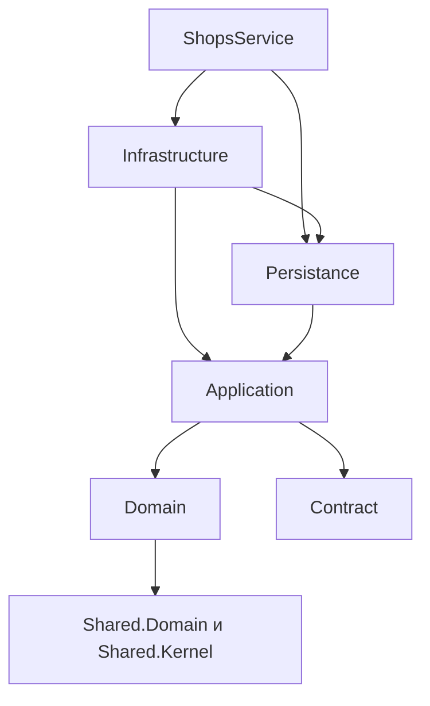

# Архитектура ShopsService и план развития

Состояние на 8 октября 2026 года. База анализа — `f0cacf555699f051dbda26f79fdad92043db02ba` с локальным исправлением атомарности обновления профиля.

**ShopsService — функционально развитый, но архитектурно неоднородный сервис.** Основа пригодна для дальнейшего развития: зависимости проектов направлены внутрь, есть доменные модели, CQRS, durable inbox/outbox, ограничения БД и значительный набор тестов. Основная проблема — разные правила реализации одинаково важных операций: валидация и бизнес-решения распределены между агрегатами, обработчиками, consumer-классами, репозиториями и SQL. Из-за этого корректность зависит от конкретного пути записи.

Цель — **модульный сервис с явным владельцем каждого набора данных, едиными правилами транзакций и согласованными контрактами чтения**. На ближайшем этапе достаточно существующего процесса и PostgreSQL. Выделять каждый модуль в отдельный сетевой сервис оснований пока нет: неизвестны реальные профили нагрузки, границы команд и потребность в независимом выпуске.

## Исправление атомарности профиля

Ранее `UpdateAdminCoffeeShopHandler` и `UpdateOwnerCoffeeShopHandler` меняли основные поля до проверки профиля. Сам `ShopProfileApplier` последовательно менял адрес, контакты, расписание и справочные связи; ошибка позднего раздела оставляла предыдущие изменения в отслеживаемой сущности. Возврат HTTP 400 через `Response` не был исключением, поэтому транзакционный адаптер Wolverine выполнял сохранение.

Теперь подготовка адреса и контактов, создание расписания и загрузка всех переданных справочников происходят до изменения агрегата. `ReplaceSchedules`, проверяющий дубликаты до изменения коллекции, выполняется перед остальными подготовленными изменениями. Основные поля и статус меняются только после успешного применения профиля. При любом возвращаемом отказе профиль остаётся неизменным. Исключения не подавляются и остаются ошибками транзакции.

Это локальное исправление обоих путей обновления профиля, а не новая глобальная политика отката всех `Response.Error` в сервисе. Сигнатуры обработчиков и API сохранены. Изменённые файлы с несколькими типами разделены согласно корневому `AGENTS.md`; миграция БД не нужна.

Код: [ShopProfileApplier.cs](C:/Users/goloo/VSCodeProjects/CoffeePeek-NET/CoffeePeek.Shops.Application/Features/CoffeeShop/ShopProfile/ShopProfileApplier.cs:28); [UpdateAdminCoffeeShopHandler.cs](C:/Users/goloo/VSCodeProjects/CoffeePeek-NET/CoffeePeek.Shops.Application/Features/Admin/Shops/UpdateAdminCoffeeShopHandler.cs:32); [UpdateOwnerCoffeeShopHandler.cs](C:/Users/goloo/VSCodeProjects/CoffeePeek-NET/CoffeePeek.Shops.Application/Features/Owner/UpdateOwnerCoffeeShopHandler.cs:31).

Добавлено 20 регрессионных сценариев: 16 отказов для двух ролей и четырёх справочников, адреса, города, контактов, расписания; 4 успешных обновления с проверкой различия `null` и пустых коллекций. После отказа проверяются отсутствие изменений в EF ChangeTracker, повторный `SaveChanges` и повторное чтение профиля. На прежней реализации 16 сценариев отказа падают, 4 успешных проходят. После исправления проходят все 20. Это проверка EF InMemory и реального репозитория, а не запуск PostgreSQL и полного HTTP → Wolverine pipeline.

Тесты: [ShopProfileAtomicityTests.cs](C:/Users/goloo/VSCodeProjects/CoffeePeek-NET/CoffeePeek.Shops.Infrastructure.Tests/Persistence/ShopProfileAtomicityTests.cs:33).

## Оценка текущего состояния

| Область | Состояние | Практическое следствие |
| --- | --- | --- |
| Зависимости проектов | В основном правильные | Domain не ссылается на Shops Persistence или Infrastructure; направление зависимостей можно сохранить |
| Границы предметных модулей | Размыты | Изменения каталога, импорта, посещений и дистрибуции приложения сходятся в одном DbContext и общем развёртывании |
| Инварианты домена | Неравномерные | Посещения защищены лучше, чем профиль кофейни и позиции меню |
| Транзакции и внешние эффекты | Механизм есть, соглашение неполное | `SaveChanges`, commit, invalidation и возврат ошибки имеют разные последствия в разных сценариях |
| CQRS и чтение | Несколько параллельных моделей | Legacy API, Discovery, карта и административные ответы могут расходиться по смыслу и составу данных |
| Асинхронные процессы | Сильные отдельные реализации | Ревизии модерации посещений — хороший образец; OCR меню требует аналогичной защиты от устаревших результатов |
| Тестируемость | Хорошая база с важным пробелом | Unit-тесты и InMemory не доказывают корректность PostgreSQL SQL, блокировок, middleware и доставки сообщений |
| Эксплуатация | Базовая инфраструктура имеется | Есть логи, телеметрия, health endpoints и durable messaging; устойчивость под нагрузкой этим не подтверждена |

Это качественная оценка кода, а не числовой рейтинг готовности production. Данные о нагрузке, инцидентах, настройках мониторинга и результатах восстановления БД в оценку не входят.

## Границы модулей и владение данными

Каталог кофе оставлен внутри Shops осознанно: это прямо зафиксировано в [coffee-catalog-plan.md](C:/Users/goloo/VSCodeProjects/CoffeePeek-NET/docs/coffee-catalog-plan.md:7). Само наличие `CoffeeProduct` рядом с кофейнями не является дефектом DDD. Проблема возникает, когда у нескольких модулей нет правил доступа к общим данным и каждый меняет их напрямую.

| Предлагаемый модуль | Чем владеет | Как взаимодействует |
| --- | --- | --- |
| Shops | Профиль кофейни, адрес, часы работы, галерея, владелец, назначения оборудования и тегов | Применяет разрешённые изменения; получает одобренные предложения от Moderation |
| Menus | Меню, позиции, фотографии меню, задания OCR и их ревизии | Ссылается на ShopId; принимает результат распознавания только для актуального задания |
| Community | CheckIn, видимость, ревизия контента, полезность, жалобы | Account владеет идентичностью; Moderation принимает решение; Community решает, к какой версии его применить |
| CoffeeCatalog | Обжарщики, продукты, источники, предложения, классификация и импорт | Импорт обновляет разрешённые поля; ручные правки сохраняют приоритет |
| Discovery | Поиск, карта, избранное, проекции для ленты | Читает данные по контрактам; не становится вторым владельцем бизнес-сущностей |
| AppDistribution | Версии приложения, каналы загрузки, APK, события скачивания | Изолированный технический модуль с возможностью последующего переноса |

Города, геозоны и справочники сначала остаются внутри существующего сервиса с явно назначенными владельцами. Их не нужно превращать в отдельный микросервис ради единой таблицы. Изменения схем и код новых модулей следует группировать по владельцу; количество `.csproj` увеличивать только если это помогает реально запретить нежелательную зависимость.

`AppDistribution` — наиболее очевидный кандидат на отдельную границу: его релизный цикл не связан с состоянием кофейни. Сейчас даже редирект скачивания использует репозиторий и UnitOfWork Shops: [GetAppDownloadRedirectHandler.cs](C:/Users/goloo/VSCodeProjects/CoffeePeek-NET/CoffeePeek.Shops.Application/Features/AppDownloads/GetAppDownloadRedirectHandler.cs:16). Первый шаг — изоляция модуля и контракта. Перенос в другой процесс оправдан независимыми требованиями к доступности, команде или нагрузке.

## Зависимости слоёв и расположение логики

Фактический граф ссылок проектов:

Граф не содержит зависимости домена от EF Shops. Поэтому переделывать его в другую популярную схему папок не требуется. Ссылка Infrastructure → Persistance сама по себе не нарушает DIP: оба являются внешними адаптерами. Существеннее то, какие решения выполняются внутри них.

Например, `ShopChangeRequestApprovedHandler` одновременно проверяет идемпотентность, выбирает бизнес-сценарий, загружает EF-граф, применяет меню и галерею, сохраняет и очищает кеш. Его обработка постоянных ошибок очищает tracking — это осознанная защита, а не отсутствующий rollback. Но владение сценариями следует перенести в Application: consumer переводит внешний контракт в команду, прикладной обработчик координирует сценарий, persistence реализует операции хранения. [ShopChangeRequestApprovedHandler.cs](C:/Users/goloo/VSCodeProjects/CoffeePeek-NET/CoffeePeek.Shops.Infrastructure/Consumers/ShopChangeRequestApprovedHandler.cs:17)

`ICoffeeCatalogStore` объединяет публичное чтение, административное изменение, теги, импорт и журнал запусков. Реализация не только читает SQL, но и решает, какие изменения допустимы. Разделить его стоит по причинам изменения: reader каталога, управление продуктом, назначения тегов и применение снимка импорта. При этом DTO-проекции и оптимизированные запросы остаются в Persistence; переносить каждое SQL-выражение в Domain не нужно. [ICoffeeCatalogStore.cs](C:/Users/goloo/VSCodeProjects/CoffeePeek-NET/CoffeePeek.Shops.Application/Features/CoffeeCatalog/ICoffeeCatalogStore.cs:6); [CoffeeCatalogStore.cs](C:/Users/goloo/VSCodeProjects/CoffeePeek-NET/CoffeePeek.Shops.Persistance/CoffeeCatalog/CoffeeCatalogStore.cs:46)

Публичные HTTP DTO и интеграционные события могут иметь похожие поля, но разные жизненные циклы. Их следует версионировать независимо, а mapping держать у границ. В перспективе прикладной результат должен описывать бизнес-ошибку (`NotFound`, `InvalidProfile`, `Conflict`), а HTTP-адаптер — статус ответа. Это постепенная миграция: текущий `Response<T>` менять сразу во всех обработчиках не требуется.

## Доменные инварианты и агрегаты

`CheckIn` уже содержит содержательную модель: ревизию контента, идентификатор отправки на модерацию, последовательность решений, версию конкурентного изменения и вычисляемую публичную видимость. Consumer проверяет, подходит ли решение текущей версии. Эти правила полезно использовать как образец для меню. [CheckIn.cs](C:/Users/goloo/VSCodeProjects/CoffeePeek-NET/CoffeePeek.Shops.Domain/Aggregates/CheckInAggregate/CheckIn.cs:39); [CheckInModerationDecidedHandler.cs](C:/Users/goloo/VSCodeProjects/CoffeePeek-NET/CoffeePeek.Shops.Infrastructure/Consumers/CheckInModerationDecidedHandler.cs:25)

`CoffeeShop.UpdateDetails`, `SetStatus` и `SetCoffeeFocus` значительно слабее: они присваивают значения, не обеспечивая все бизнес-инварианты. В меню правила создания и изменения позиции расходятся; дополнительный SQL upsert создаёт ещё один путь применения тех же правил. Цель — одинаковая семантика для администратора, владельца, модерации и импорта. На границе проверяются формат, обязательность и права, внутри домена — допустимость состояния независимо от вызывающего кода. FK, unique и check constraints обеспечивают финальную защиту данных. [CoffeeShop.cs](C:/Users/goloo/VSCodeProjects/CoffeePeek-NET/CoffeePeek.Shops.Domain/Aggregates/CoffeeShopAggregate/CoffeeShop.cs:106); [MenuRepositories.cs](C:/Users/goloo/VSCodeProjects/CoffeePeek-NET/CoffeePeek.Shops.Persistance/Repositories/MenuRepositories.cs:104)

У `Equipment.IsPrimary` слишком широкая область действия для свойства «основное оборудование кофейни»: оно хранится в общей сущности оборудования, используемой many-to-many. `CoffeeShop.AddEquipment` может снять этот флаг с существующего оборудования. Если «основное» действительно относится к конкретной кофейне, его место — в сущности связи `ShopEquipment`, а справочник модели машины должен оставаться общим и независимым. Это риск модели, а не утверждение о уже испорченных production-данных. [CoffeeShop.cs](C:/Users/goloo/VSCodeProjects/CoffeePeek-NET/CoffeePeek.Shops.Domain/Aggregates/CoffeeShopAggregate/CoffeeShop.cs:304); [CoffeeShopConfiguration.cs](C:/Users/goloo/VSCodeProjects/CoffeePeek-NET/CoffeePeek.Shops.Persistance/Configuration/CoffeeShopConfiguration.cs:151)

Read-only setter не делает коллекцию неизменяемой. Например, публичный `CoffeeZone.Polygon` позволяет изменить вершины без пересчёта центра и радиуса. Аналогично `CoffeeProduct.Sources` и `Countries` доступны как изменяемые списки. Нужны закрытые коллекции и методы изменения, обеспечивающие инварианты и версию. Это следует вводить по одному агрегату, сохраняя совместимость EF mapping. [CoffeeZone.cs](C:/Users/goloo/VSCodeProjects/CoffeePeek-NET/CoffeePeek.Shops.Domain/Aggregates/CoffeeZoneAggregate/CoffeeZone.cs:32); [CoffeeProduct.cs](C:/Users/goloo/VSCodeProjects/CoffeePeek-NET/CoffeePeek.Shops.Domain/Aggregates/CoffeeProductAggregate/CoffeeProduct.cs:38)

## Транзакции события и кеш

Wolverine уже настроен на EF transactions, durable inbox, outbox и локальные очереди. Это сильная часть текущей архитектуры. Отсутствие outbox не является проблемой этого проекта. [WolverineModule.cs](C:/Users/goloo/VSCodeProjects/CoffeePeek-NET/CoffeePeek.Shared.Persistence/Extensions/WolverineModule.cs:75)

Нужно закрепить единое соглашение для команд:

1. Проверить полномочия и входные данные, загрузить необходимые ссылки.
2. Проверить все ожидаемые условия отказа до изменения отслеживаемого состояния.
3. Изменить агрегат и зарегистрировать исходящие сообщения в той же транзакции.
4. Выполнить финальный commit на границе UnitOfWork/Wolverine.
5. Применить повторяемые внешние эффекты после commit через durable сообщения.

`SaveChanges` внутри активной транзакции не равен commit. Раннее сохранение допустимо для получения значения из БД или обнаружения конфликта, но причина должна быть явной. Механическое удаление всех вызовов `SaveChanges` может сломать существующие сценарии.

Поддержка автоматического сохранения описана в [документации Wolverine](https://github.com/jasperfx/wolverine/blob/main/docs/guide/durability/efcore/transactional-middleware.md). Для конкретной версии проекта решающим свидетельством служит локальный сгенерированный адаптер: после вызова обработчика он сохраняет и коммитит; исключение приводит к откату. Изменять generated-файлы вручную не следует.

Часть кеша инвалидируется непосредственно внутри обработчиков до внешнего commit. Это допускает заполнение старым значением между invalidation и commit. В проекте уже есть более надёжный пример — `CheckInCacheInvalidationRequested` с durable доставкой и retry при ошибке Redis. Его подход стоит унифицировать, а для защиты от медленного параллельного заполнения дополнить поколениями ключей или проверкой версии. Одна только отправка события после commit не устраняет все гонки cache-aside. [CheckInCacheInvalidationRequestedHandler.cs](C:/Users/goloo/VSCodeProjects/CoffeePeek-NET/CoffeePeek.Shops.Infrastructure/Consumers/CheckInCacheInvalidationRequestedHandler.cs:13)

OCR меню стоит разделить на два этапа: внешнее распознавание и короткую транзакцию применения сохранённого результата. В задании нужны `JobId`, `MenuId`, версия исходного меню и состав фотографий. Применение проверяет актуальность версии и повторяемость задания; запоздавший ответ не восстанавливает удалённые фото. Сейчас скачивание, платный вызов модели и применение результата находятся в одном обработчике, а локальные retries уже вынуждены отдельно защищаться от повторной оплаты. [ParseMenuRequestedEventHandler.cs](C:/Users/goloo/VSCodeProjects/CoffeePeek-NET/CoffeePeek.Shops.Infrastructure/Consumers/ParseMenuRequestedEventHandler.cs:17)

Связь с Media требует отдельного протокола: HTTP-reservation не откатывается вместе с локальной БД. Стабильная идентичность посещения для повторного запроса уже предусмотрена. Сохранять эту защиту и проверять потерянный ответ, повторную доставку и зависшую reservation важнее, чем заменять её общей «распределённой транзакцией». [CreateUnifiedCheckInHandler.cs](C:/Users/goloo/VSCodeProjects/CoffeePeek-NET/CoffeePeek.Shops.Application/Features/CheckIn/CreateUnifiedCheckInHandler.cs:54)

## Чтение поиск и производительность

Для чтения лучше использовать специализированные DTO-проекции с явным составом данных, а не передавать частично загруженный агрегат в универсальный mapper. Административный список сейчас возвращает агрегаты без всех коллекций, хотя DTO обещает фотографии и справочные связи. Разделение `Summary` и `Details` либо полноценная проекция сделают контракт проверяемым. [CoffeeShopRepository.cs](C:/Users/goloo/VSCodeProjects/CoffeePeek-NET/CoffeePeek.Shops.Persistance/Repositories/CoffeeShopRepository.cs:97)

Legacy-поиск, Discovery и карта должны иметь общую спецификацию семантики: скрытые/закрытые кофейни, удалённые посещения, отсутствие часов работы, часовой пояс, рейтинг и активность справочников. Сейчас legacy/domain трактуют отсутствие расписания как открыто, а Discovery возвращает `IsOpen = null` и исключает такие записи из обоих boolean-фильтров. Возможно, это намеренное развитие API; решение должен определить продуктовый контракт, после чего его нужно зафиксировать одинаковыми наборами примеров. [DiscoveryQueryStore.Shops.cs](C:/Users/goloo/VSCodeProjects/CoffeePeek-NET/CoffeePeek.Shops.Persistance/Discovery/DiscoveryQueryStore.Shops.cs:163); [CoffeeShop.cs](C:/Users/goloo/VSCodeProjects/CoffeePeek-NET/CoffeePeek.Shops.Domain/Aggregates/CoffeeShopAggregate/CoffeeShop.cs:365)

Не нужно переиспользовать весь запрос ради DRY: SQL-проекция и вычисление в памяти имеют разные ограничения. Переиспользовать следует правило и тестовые случаи, проверяя эквивалентность результатов обеих реализаций.

Карта агрегирует ограниченное число точек в памяти; лимит исходных данных должен отражаться в `IsTruncated`. При росте каталога нужны измерения `EXPLAIN ANALYZE`, числа SQL-запросов, памяти и p95/p99. Только после измерений выбирать SQL grid aggregation, пространственные индексы или отдельную read model. Само наличие лимита 20 000 не доказывает текущую проблему нагрузки. [CoffeeShopQueries.cs](C:/Users/goloo/VSCodeProjects/CoffeePeek-NET/CoffeePeek.Shops.Persistance/Queries/CoffeeShopQueries.cs:351)

В legacy-поиске остались неиспользуемая cache dependency и вычисление hash. Их удаление упростит понимание фактического поведения. Важно не приписывать этому пути устаревшие результаты кеша, который он сейчас не читает. [SearchCoffeeShopsHandler.cs](C:/Users/goloo/VSCodeProjects/CoffeePeek-NET/CoffeePeek.Shops.Application/Features/CoffeeShop/SearchCoffeeShops/SearchCoffeeShopsHandler.cs:16)

## Применение DDD DRY KISS и SOLID

| Подход | Что следует изменить | Что не требуется |
| --- | --- | --- |
| DDD | Владельцы данных, границы агрегатов, инварианты, ревизии асинхронных операций | Превращать каждый справочник в отдельный bounded context или процесс |
| DRY | Единые правила меню, видимости и расписания; общая спецификация и тестовые примеры | Объединять разные DTO и запросы только из-за похожих полей |
| KISS | Удалить неиспользуемые зависимости, явно описать transaction boundary, разделить неоднородные store API | Вводить event sourcing, отдельную БД для каждого модуля или универсальный framework handlers |
| SRP | Разделить координацию сценария, бизнес-решение, SQL и интеграционный transport | Создавать класс для каждой строки логики |
| OCP | Изолировать реально изменяемые интеграции и политики импорта | Заменять каждый switch по закрытому enum фабрикой и иерархией |
| LSP | Проверять одинаковую семантику разных реализаций хранения контрактными тестами | Объявлять нарушение без конкретного несовместимого поведения |
| ISP | Разделить `ICoffeeCatalogStore` по потребителям и сценариям | Раздувать набор интерфейсов без независимых клиентов |
| DIP | Держать сценарии и порты в Application, адаптеры снаружи; сохранить независимость Domain от EF Shops | Перестраивать весь граф проектов из-за ссылки между двумя внешними слоями |

## Порядок перехода и критерии завершения

| Этап | Изменение | Когда считать завершённым |
| --- | --- | --- |
| Выполнено | Атомарное обновление admin/owner профиля | После 400 нет изменений tracking и повторное сохранение не меняет данные; 20 новых сценариев проходят |
| Следующий приоритет | Защита меню и целостности ссылок | Старый OCR и повторное задание не меняют новую версию; невалидные цены/объёмы отклоняются всеми путями; удаление используемого города запрещено согласованно с FK |
| Единые правила записи | Документированная transaction boundary и durable invalidation | Тесты через реальный Wolverine + PostgreSQL проверяют error-after-load, rollback, commit и outbox; сбой Redis не превращает подтверждённую запись в ложный отказ |
| Контракты чтения | Явные summary/details и семантика фильтров | API-тесты проверяют фотографии, справочники, удалённые посещения, отсутствие расписания и усечение карты |
| Модульные границы | Владельцы таблиц, узкие порты, перенос сценариев из infrastructure/store | У каждой записи один прикладной владелец; architecture tests запрещают обращения к чужой реализации хранения |
| Укрепление модели | ShopEquipment, закрытые коллекции, одинаковые инварианты | Ни один разрешённый публичный метод не обходит правило; миграции проверены на существующих данных |
| Эксплуатационная проверка | Нагрузка, сбои, доставка, восстановление | Есть измеренные бюджеты задержки, мониторинг очередей/DLQ, инструкция replay и проверенная процедура восстановления |

План не требует большой переписи. Каждый этап можно выпускать отдельно с сохранением существующих маршрутов. Изменения контрактов — через совместимый период и миграцию клиентов; изменения данных — через предварительный поиск нарушений, backfill и затем constraint. Перенос модулей в самостоятельные сервисы рассматривается после стабилизации границ, а не используется как способ их найти.

## Проверки и ограничения

После исправления выполнены `dotnet test` для четырёх проектов Shops: Domain — 206, Application — 238, Infrastructure — 305, Host — 78 успешных тестов. Итого **827 passed, 24 skipped, 0 failed**. Пропущены проверки, требующие настроенного live PostgreSQL. При сборке остаются существующие предупреждения nullable, XML documentation и xUnit.

Новые тесты доказывают неизменность профиля при известных отказах и сохранение успешных обновлений. Они не заменяют тест реального transactional middleware, SQL upsert, межпроцессной доставки, конкурентных запросов PostgreSQL и отказов RabbitMQ/Redis/Media. Именно эти проверки должны стать следующим обязательным уровнем CI для изменений записи и интеграций.

Архитектурные выводы основаны на зависимостях проектов, моделях, обработчиках, persistence, конфигурации messaging, API и тестах. Исправлена только критическая проблема атомарности профиля. Остальные дефекты предыдущего аудита и предложенные архитектурные изменения остаются отдельными задачами.
