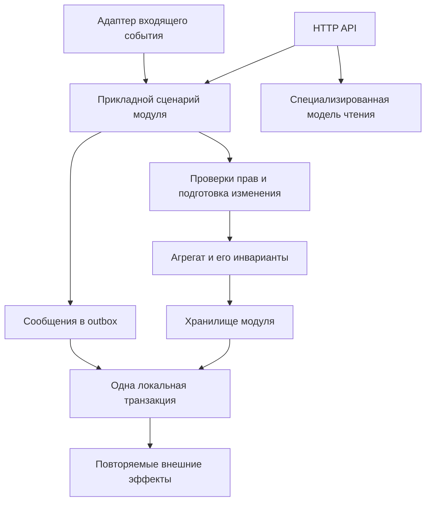

# План перехода ShopsService к модульной архитектуре

Дата: 8 октября 2026 года. Статус: реализация начата; актуальный прогресс и ограничения проверки ведутся в [журнале реализации](shops-implementation-status.md). Этот план фиксирует целевое состояние и критерии приёмки, а не утверждает, что все задачи уже завершены.

Основание — [архитектурный аудит](shops-architecture-audit.md). Исправление частичного сохранения профиля при HTTP 400 уже выполнено в предыдущей работе и входит в исходное состояние. Его нужно сохранить и дополнительно проверить через настоящий transactional pipeline. Остальные проблемы не считаются исправленными.

## Цель и границы работы

Получить один модульный ShopsService, в котором у данных есть определённый владелец, агрегаты защищают свои инварианты, все пути записи подчиняются одному транзакционному соглашению, а чтение соответствует согласованным бизнес-правилам. PostgreSQL, RabbitMQ, Redis и Media проверяются на интеграционном уровне, включая сбои и конкуренцию.

На первом этапе сохраняются один процесс ShopsService, одна БД Shops и существующие проекты Domain, Application, Infrastructure, Persistance и Host. Модули выделяются через явные интерфейсы, расположение сценариев, владельцев таблиц и автоматические проверки зависимостей. Новый проект допустим, если без него нельзя надёжно обеспечить границу; отдельный проект для каждой папки не является целью.

В план не входят выделение новых сетевых сервисов, event sourcing, полная замена Wolverine/EF Core, переименование принятых в репозитории опечаток и изменение бизнес-продукта без отдельного решения. Account, Media, Moderation и Gateway затрагиваются только в пределах совместимости интеграционных контрактов. Любое расширение этой области должно стать явно выделенной задачей.

## Целевая карта модулей

Это предлагаемое распределение, которое нужно закрепить в P03 после инвентаризации, включая спорные таблицы и вспомогательные сущности.

| Модуль | Владеет записью | Предоставляет другим модулям |
| --- | --- | --- |
| Shops | Профиль кофейни, владелец, адрес, расписание, галерея, города и зоны; справочники оборудования, brew methods, beans и shop tags; назначения этих справочников | Проверка существования/доступности кофейни, разрешённые команды изменения, факты о профиле |
| Menus | Меню, позиции и фотографии меню, определения напитков, задания OCR и сохранённые результаты | Чтение меню, применение ручных правок, актуальный статус обработки |
| Community | Посещения, ревизии контента, видимость, рейтинги, полезность, жалобы, политика публичной ленты | Публично допустимые проекции и агрегированная статистика |
| CoffeeCatalog | Обжарщики и их теги, продукты, источники, варианты покупки, классификация, запуск и результат импорта | Идентичность обжарщика, каталог и предложения, команды импорта |
| Discovery | Поисковые проекции, карта и фасеты, пользовательское избранное | Публичные поисковые и навигационные ответы; изменение только собственных данных избранного/проекций |
| AppDistribution | Релизы приложения, каналы скачивания, настройки, журнал загрузок | Версии и ссылки скачивания через стабильный API |

Связи кофейни с обжарщиком принадлежат Shops; сущность обжарщика — CoffeeCatalog. Кофейня не редактирует обжарщика через navigation property. Media владеет файлами и протоколом их получения/резервирования; модули ShopsService владеют назначением файла конкретному содержимому. Public addresses — сквозная техническая возможность с единым механизмом уникальности, но право переименовать публичный адрес остаётся у владельца сущности.

Discovery может выполнять согласованные SQL joins по данным нескольких модулей как read adapter. Это явно описанное исключение для чтения, а не разрешение менять чужие агрегаты. Community определяет, какие посещения публичны; Discovery не вводит собственную трактовку этой видимости.

Общий DbContext временно остаётся технической точкой сборки модели. Сам факт его существования не даёт каждому модулю право писать во все DbSet. Ограничения проверяются по фактическим ссылкам на типы, операциям записи и реестру исключений; проверка только имён папок недостаточна.

## Решения которые должны предшествовать зависимому коду

P02 оформляет решения с примерами входа и выхода. Агент предлагает вариант и фиксирует основания; изменение публичного поведения при неоднозначных требованиях должно быть согласовано с владельцем продукта. Пока решения нет, зависимая задача ограничивается инвентаризацией и воспроизведением текущего поведения.

| Вопрос | Предлагаемое направление | Что зависит от решения |
| --- | --- | --- |
| Нет расписания | Явное состояние Unknown; определить совместимость старого boolean API | Фильтры открытости, карточки и карта |
| Часовой пояс | Сначала сохранить текущий UTC-контракт; отдельно решить, требуется ли локальное время города и DST | Хранение расписаний, преобразования, переходы через полночь |
| Цена и объём напитка | Недопустимые отрицательные значения запрещены; ноль, неизвестные значения и отсутствие напитка определить отдельно | Домен меню, SQL constraints, OCR и ручной API |
| Несколько порций напитка | Сохранять согласованную пару цена/объём; выбрать одну порцию или модель нескольких предложений | Парсер, uniqueness позиции, API меню |
| Устаревший OCR | Результат применим только к подходящей версии задания и входных фото; ручная правка имеет определённый приоритет | Revision protocol и слияние результатов |
| Удаление справочника | Используемые сущности по умолчанию деактивируются либо удаление отклоняется; физическое удаление имеет явные ограничения | Города, оборудование, теги, обжарщики и FK |
| Основное оборудование | Признак принадлежит назначению в конкретной кофейне, если продукт подтверждает этот смысл | ShopEquipment и backfill |
| Конкурентная правка | Определить конфликт/повторное применение по каждому сценарию; не перезаписывать ручные данные молча | Версии агрегатов и API conflict response |
| Атомарность пакетного запроса | По умолчанию весь command успешен либо не меняет состояние; частичный импорт имеет отдельный контракт | Result/error policy и импорт |
| Публичный API | Действующие поля сохраняются; изменения смысла проходят через совместимый адаптер или новую версию | Summary/details и унификация ошибок |

## Единое соглашение записи

1. HTTP и consumer проверяют транспортный формат и идентичность вызывающего. Авторизация и проверка владельца обязательны также в самом прикладном сценарии, если он доступен нескольким входам.
2. Прикладной сценарий загружает необходимые ссылки и подготавливает изменение. Ожидаемый отказ до мутации не оставляет изменённый tracking и не публикует исходящие бизнес-события.
3. Агрегат проверяет свои инварианты независимо от API. Методы, возвращающие отказ, не оставляют частично изменённое состояние. Persistence не вводит альтернативные бизнес-правила.
4. Изменение агрегата, ключ идемпотентности и исходящие сообщения фиксируются одной локальной транзакцией. Вложенные вызовы модулей не создают независимые commit.
5. Wolverine владеет финальным commit для обработчиков в его pipeline. Сценарии вне pipeline используют явно оформленный UnitOfWork. Ранний SaveChanges разрешён только с документированной причиной и остаётся внутри этой транзакции.
6. Ошибка после начала мутации приводит к откату; её преобразование в HTTP-ответ не должно превратить неуспешную транзакцию в успешное завершение middleware. Конкретный механизм выбирается и проверяется в P06. Глобальный `ChangeTracker.Clear()` не используется как замена откату уже выполненного SQL.
7. Retry разрешён для перечисленных транзиентных ошибок. Он повторяет сценарий на новом контексте, с сохранением идемпотентности; конфликт редактирования пользователя не маскируется бесконечным retry.
8. Redis, HTTP, RabbitMQ и платный OCR не становятся участниками локальной БД-транзакции. Для них определяются durable доставка, ключ повторения, сохранённый результат, резервирование или компенсация. Платный вызов не повторяется из-за ошибки сохранения уже полученного результата.
9. Ошибка после подтверждённого commit не должна сообщать клиенту, что сама запись отклонена. Неопределённый исход commit имеет отдельную стратегию проверки по ключу идемпотентности.
10. Читающие сценарии не меняют бизнес-данные скрытно. `GetOrCreate`, логирование скачивания и похожие операции явно классифицируются как запись либо разделяются на чтение и отдельный эффект.

## Организация работы агентов

Названия ниже обозначают роли, а не уже запущенных агентов. Одна роль может последовательно выполнять несколько задач. При четырёх доступных слотах разумный максимум — координатор и три исполнителя. Параллельность допускается только после закрытия зависимостей и согласования пересечений файлов.

| Роль | Ответственность |
| --- | --- |
| Координатор | Зависимости, контракты, общие файлы, сборка результатов и актуальный статус плана |
| Архитектура | Владельцы модулей, ADR, порты и автоматические проверки границ |
| Запись и интеграции | Транзакции, outbox, ошибки, кеш, протоколы Media/Moderation |
| Домен Shops | Профиль, справочники, назначения оборудования, города и зоны |
| Меню | Инварианты меню, SQL-путь, OCR jobs и применение результатов |
| Каталог | CoffeeProduct, управление каталогом и импорт |
| Community | Посещения, видимость, рейтинги, жалобы, конкуренция |
| Чтение | Проекции, административные ответы, поиск и карта |
| БД | Миграции, model snapshot, ограничения, preflight и backfill |
| Проверки и эксплуатация | Test harness, CI, отказоустойчивость, нагрузка и эксплуатационные инструкции |

У `ShopsDbContext`, EF model snapshot, migrations, composition root, общих contracts, solution и CI всегда один текущий писатель. Другие агенты передают ему конкретное требование и тест. Миграции создаются последовательно на общей принятой модели; нельзя независимо генерировать несколько конкурирующих snapshot и затем механически объединять их.

Каждая задача заканчивается небольшим проверяемым изменением. Крупную карточку можно делить на последовательные PR с её префиксом, но нельзя объявлять карточку завершённой до выполнения всех критериев. Массовое перемещение файлов не объединяется с изменением бизнес-поведения. Один top-level тип на файл; namespace, тип сообщения и имя consumer сохраняются, пока не выполнен план совместимости P27.

## Реестр задач

Индивидуальный статус карточек ведётся в [журнале реализации](shops-implementation-status.md). Зависимости ниже — условия начала реализации, а не запрет на предварительное чтение. P01–P03 формируют первую точку принятия решений. Завершение задачи включает общий Definition of Done в конце документа.

### P01 Зафиксировать исходное состояние

- **Агент:** координатор и проверяющий. **Зависимости:** нет.
- **Область:** текущие изменения, четыре тестовых проекта Shops, документация аудита; без нового рефакторинга.
- **Работа:** отделить уже выполненное исправление атомарности от будущих задач; зафиксировать принятую базу, существующие предупреждения, тесты и ограничения окружения. Инвентаризировать публичные маршруты, handlers, фоновые задания и прямые пути записи SQL.
- **Результат:** воспроизводимая исходная версия, список известных дефектов, реестр write entry points и исходные контрактные примеры.
- **Приёмка:** чужие незавершённые изменения не потеряны; известны выполненные и пропущенные проверки. Числа 827/24 из аудита обозначены исторической базой, а не гарантией текущего состояния при будущем запуске.

### P02 Зафиксировать бизнес правила и таблицы решений

- **Агент:** архитектура совместно с владельцем продукта. **Зависимости:** P01.
- **Область:** расписания, видимость, меню, удаление справочников, приоритет ручных правок и конфликтов.
- **Работа:** разрешить вопросы из таблицы решений; описать валидные, невалидные и пограничные состояния, включая null/empty, неизвестный enum, скрытый объект и повторный запрос.
- **Результат:** согласованные ADR и наборы примеров, пригодные для domain/API/SQL-тестов.
- **Приёмка:** у каждого неоднозначного случая есть ожидаемый результат и стратегия совместимости; агент не подменяет неизвестное бизнес-требование собственным предположением.

### P03 Утвердить владельцев данных и модульные контракты

- **Агент:** архитектура. **Зависимости:** P01, P02.
- **Область:** Domain, Application, Persistance, Infrastructure, Host и границы Contract.
- **Работа:** сопоставить каждую таблицу и write handler одному модулю; определить порты, read-only joins, допустимые межмодульные атомарные сценарии и владение public addresses. Отдельно описать общие сущности фото и справочников.
- **Результат:** карта типов/таблиц/операций, схема зависимостей, перечень разрешённых исключений и план размещения кода без обязательного массового переименования.
- **Приёмка:** нет таблиц с двумя независимыми владельцами записи; межмодульная операция имеет явно назначенного координатора; каждый внешний контракт имеет владельца.

### P04 Подготовить настоящий интеграционный контур

- **Агент:** проверки и эксплуатация. **Зависимости:** P01.
- **Область:** существующие LivePostgres fixtures, ShopsService.Tests, тестовые настройки Wolverine, RabbitMQ, Redis и HTTP doubles.
- **Работа:** расширить имеющийся harness, а не создавать конкурирующий. Поддержать изолированную БД с production migrations, production-регистрацию pipeline и вызов через HTTP/IMessageBus. Разделить быстрые PG-тесты и более дорогие broker/Redis/end-to-end suites.
- **Результат:** тестовые fixtures, профили запуска, управляемые точки отказа и сбора диагностик.
- **Приёмка:** отсутствие настроенного обязательного ресурса в CI проваливает job; локальный opt-in остаётся явным. Сохраняются ограничения `COFFEEPEEK_LIVE_PG`, pgpass и создание/удаление только тестовых БД. Проверяется профиль admin/owner после 400 в настоящем pipeline.

### P05 Ввести автоматические проверки архитектурных границ

- **Агент:** архитектура. **Зависимости:** P03.
- **Область:** отдельный набор architecture tests и правила анализа production-кода.
- **Работа:** запретить Domain → EF/HTTP/host, Application → конкретная Persistence/Infrastructure, запись чужих агрегатов и доступ к внутренним реализациям модулей. Учесть allowlist read projections и composition root. Проверять реальные зависимости типов/вызовов, не только namespace.
- **Результат:** исполняемые правила и временный реестр существующих нарушений с владельцем и задачей удаления.
- **Приёмка:** намеренное внесение запрещённой зависимости делает тест красным; generated-код исключён только из неприменимых правил; baseline не разрешает новые нарушения.

### P06 Установить единый протокол ошибок и транзакций

- **Агент:** запись и интеграции. **Зависимости:** P02, P03, P04.
- **Область:** Shops Application, адаптер HTTP, подключение Wolverine/UnitOfWork; Shared меняется лишь при доказанной необходимости и с проверками других сервисов.
- **Работа:** определить typed application failures, boundary mapping и владение commit. Перенести один вертикальный сценарий профиля на соглашение; проверить ранний SaveChanges, прямой SQL, ошибку после мутации и выполнение вне bus.
- **Результат:** ADR, минимальный механизм для Shops и эталонный сценарий с тестами.
- **Приёмка:** при отказе нет частичной записи и исходящего бизнес-события; успешная команда фиксируется атомарно; HTTP status преобразуется вне успешного commit ошибочного сценария. Generated adapters проверены после регенерации штатным способом.

### P07 Унифицировать исходящие события и идемпотентность

- **Агент:** запись и интеграции. **Зависимости:** P06.
- **Область:** publication points, обработчики входящих событий, durable inbox/outbox.
- **Работа:** составить реестр delivery guarantees, business idempotency keys, версий и retry policy. Различать повтор envelope и повтор бизнес-операции с новым envelope. Запись результата и deduplication marker объединить транзакцией.
- **Результат:** соглашение событий и перенос первого сквозного сценария; шаблоны тестов для остальных модулей.
- **Приёмка:** сбой брокера после commit не теряет событие; повтор бизнес-запроса не дублирует эффект; rollback не оставляет сообщение, обещающее несуществующее изменение.

### P08 Перенести инвалидирование кеша за границу commit

- **Агент:** запись и интеграции. **Зависимости:** P07.
- **Область:** кеш городов, профиля, статистики и другие реально читаемые ключи; существующий durable invalidation handler.
- **Работа:** сопоставить read/write keys, устранить invalidation до commit, повторно использовать durable механизм. Выбрать защиту от запоздалого cache fill через поколения/версии; определить TTL и допустимую stale window.
- **Результат:** единая политика кеша, реализация по активным ключам, удаление доказанно неиспользуемых зависимостей.
- **Приёмка:** Redis outage не отменяет подтверждённый business commit; invalidation восстанавливается; детерминированный тест медленного читателя не возвращает старое поколение после смены версии. Не вводить кеш там, где его сейчас нет, ради этой задачи.

### P09 Обеспечить целостность городов и справочных ссылок

- **Агент:** домен Shops и БД. **Зависимости:** P02, P03, P04, P06.
- **Область:** города, Location кофеен/обжарщиков, зоны, delete/deactivate handlers, EF mapping.
- **Работа:** найти осиротевшие ссылки; определить ограничение удаления и API conflict; добавить ограничения БД и обработку гонки delete/reference-create. Для существующих нарушений подготовить отчёт и явную политику восстановления.
- **Результат:** доменное поведение, PG-тесты, миграция под контролем владельца схемы и preflight.
- **Приёмка:** нельзя удалить используемый город либо создать новую ссылку на удалённый город; применяется ожидаемый статус ошибки; существующие данные не удаляются и не переназначаются молча.

### P10 Защитить агрегат CoffeeShop

- **Агент:** домен Shops. **Зависимости:** P02, P03, P06.
- **Область:** создание и изменение профиля, контакты, адрес, расписание, статус, focus, теги и галерея.
- **Работа:** перенести инварианты внутрь домена; обеспечить одинаковые правила для admin, owner, moderation и import. Методы validate-then-apply не оставляют частично изменённый агрегат. Определить защиту от конкурентного редактирования и обновления коллекций.
- **Результат:** защищённые методы и общие доменные примеры; корректная обработка доменных отказов на входах.
- **Приёмка:** неверные имена, длины, enum и дубликаты отклоняются согласованно; ошибка позднего поля не меняет ранние; не теряется чужая параллельная правка. Исправление P1 остаётся покрыто regression tests.

### P11 Перенести свойства назначения оборудования в ShopEquipment

- **Агент:** домен Shops и БД. **Зависимости:** P09, P10.
- **Область:** Equipment, связь кофейни с оборудованием, API mapping и миграция связей.
- **Работа:** отделить общую модель оборудования от признаков назначения; обеспечить принятую уникальность primary по категории и кофейне. Разработать backfill, учитывающий неоднозначность старого глобального IsPrimary.
- **Результат:** сущность назначения, совместимый API и миграция с диагностикой неоднозначных строк.
- **Приёмка:** изменение основной машины одной кофейни не меняет другую; уникальность выдерживает конкуренцию; backfill не заявляет восстановленным смысл, которого нет в исходных данных.

### P12 Закрыть обход инвариантов географии и коллекций Shops

- **Агент:** домен Shops. **Зависимости:** P09, P10.
- **Область:** CoffeeZone.Polygon, производные координаты/радиус, коллекции и value objects профиля.
- **Работа:** предоставить read-only представления и изменения только через методы; исключить изменение вложенных объектов через выданную коллекцию. Центр, радиус и версия пересчитываются вместе с полигоном.
- **Результат:** защищённая модель и совместимый EF mapping.
- **Приёмка:** ни изменение исходного списка после вызова, ни изменение полученного значения не меняет агрегат в обход метода; PG round-trip сохраняет геометрию и производные поля.

### P13 Сделать правила меню едиными

- **Агент:** меню. **Зависимости:** P02, P03, P06.
- **Область:** ShopMenu, ShopMenuItem, ручные команды, модерация, парсер и каталог напитков.
- **Работа:** определить политику price/volume/availability, неизвестных и неактивных slug, ручных полей и нескольких порций. Устранить тихое пропускание строк. Выбор OCR-предложения сохраняет цену и объём из одного предложения.
- **Результат:** один набор доменных правил и одинаковые примеры для всех входов.
- **Приёмка:** invalid row отклоняет весь заявленный атомарный запрос; Create и ApplyManual эквивалентны; цена 8 за 200 мл не становится ценой 8 за 300 мл при объединении результатов.

### P14 Согласовать SQL upsert меню с доменом

- **Агент:** меню и БД. **Зависимости:** P04, P13.
- **Область:** MenuRepositories, tracked и SQL-пути, menu constraints.
- **Работа:** оставить SQL-оптимизацию только с общей подготовкой валидного изменения; согласовать absent/null, uniqueness, конкурентное создание и ручной приоритет. После raw SQL исключить выдачу устаревшего tracking.
- **Результат:** эквивалентные реализации хранения и PostgreSQL contract suite.
- **Приёмка:** одинаковые примеры дают одинаковое состояние через EF и SQL; constraint защищает обход приложения; конкурентные запросы не создают дубликаты и не теряют ручные данные.

### P15 Ввести жизненный цикл задания OCR

- **Агент:** меню. **Зависимости:** P07, P13.
- **Область:** request/result OCR, модель job, snapshots фотографий, варианты статусов.
- **Работа:** определить JobId, идентичность входов, версию меню, состояния задания и разрешённые переходы. Разделить внешний вызов и короткую транзакцию применения; сохранять полученный результат для повторного применения без нового платного вызова.
- **Результат:** ADR state machine, модель задания, совместимые контракты и схема хранения.
- **Приёмка:** смена фото/ручная правка делает старый job неприменимым по определённому правилу; повтор job определяется; crash после ответа провайдера имеет явно описанное окно неопределённости и стратегию восстановления. Не обещать exactly-once billing без поддержки провайдера.

### P16 Перевести применение OCR на версионный протокол

- **Агент:** меню. **Зависимости:** P14, P15, P27.
- **Область:** ParseMenuRequestedEventHandler, ApplyShopMenuService, snapshot handlers.
- **Работа:** применять только актуальный результат, фиксировать применение атомарно с состоянием job; обработать устаревший, повторный, failed и cancelled job. Удалённая фотография не добавляется обратно из старого snapshot.
- **Результат:** production-путь OCR по новому протоколу, политика перехода для старых сообщений.
- **Приёмка:** тесты A→B и B→A порядка ответов, удаления фото, ручной правки во время OCR, redelivery, restart и ошибки commit проходят на PostgreSQL; retry применения не вызывает модель повторно.

### P17 Упорядочить адаптеры Moderation и Media

- **Агент:** запись и интеграции. **Зависимости:** P07, P10, P13, P27.
- **Область:** входящие moderation consumers, прикладные сценарии применения, photo reservation/claim/finalization.
- **Работа:** перенести бизнес-координацию из consumer в владельца модуля; сохранить business idempotency и сообщения постоянного отказа. Описать восстановление при потерянном HTTP-ответе Media, неопределённом локальном commit и незавершённом резервировании.
- **Результат:** тонкие адаптеры, прикладные команды и документированные интеграционные протоколы.
- **Приёмка:** старое решение не публикует новую ревизию; другой пользователь не присваивает фото; повтор сообщения не дублирует изменения; rollback не освобождает файл, который мог быть успешно привязан. Совместимость сервисов проверена.

### P18 Закрепить границу Community и сохранить её гарантии

- **Агент:** Community. **Зависимости:** P06, P07, P03.
- **Область:** CheckIn, votes, reports, visibility, rating/feed eligibility и репозитории.
- **Работа:** собрать сценарии в модуле, сохранить revisions/submission/decision sequence и concurrency token. Общие правила публичности и удаления использовать в ленте, рейтингах и доступе к фото. Зафиксировать ограничения количества посещений и поведение конкурентных votes/reports.
- **Результат:** единая политика видимости и модулярные порты без ослабления действующих защит.
- **Приёмка:** hide/delete/edit с запоздалой модерацией не публикует закрытый контент; дубли не искажают helpful count; приватные посещения не попадают в публичные проекции; PostgreSQL race tests подтверждают лимиты.

### P19 Защитить агрегаты CoffeeCatalog

- **Агент:** каталог. **Зависимости:** P02, P03, P06.
- **Область:** CoffeeProduct, sources, variants, countries, classification и защищённые ручные поля.
- **Работа:** закрыть изменяемые коллекции и массивы, централизовать version increment и допустимые переходы публикации. Отделить происхождение продукта, идентичность продавца и предложение. Установить права изменения импортом и администратором.
- **Результат:** доменные операции, не позволяющие обойти protected fields или обновление версии.
- **Приёмка:** изменение источника/страны/варианта через публичный API модели либо выполняет инварианты и версионирование, либо невозможно; ручные правки не теряются при конкурентном импорте; неизвестное значение не превращается в выдуманный факт.

### P20 Разделить CoffeeCatalogStore по сценариям

- **Агент:** каталог. **Зависимости:** P19, P03.
- **Область:** ICoffeeCatalogStore, CoffeeCatalogStore partials, административные и публичные handlers.
- **Работа:** выделить порты чтения, управления продуктом/тегами и импорта; бизнес-координацию перенести в Application. SQL projections оставить в Persistence. Прямые записи из соседних модулей заменить вызовами владельца.
- **Результат:** узкие интерфейсы по потребителям, прикладные сценарии и compatibility adapter для постепенного перехода.
- **Приёмка:** read consumer не зависит от admin/import API; persistence не принимает бизнес-решение о ручном приоритете; маршруты и формы ответов совместимы; старый универсальный интерфейс удаляется после миграции всех клиентов.

### P21 Сделать применение импорта воспроизводимым

- **Агент:** каталог. **Зависимости:** P07, P20, P27.
- **Область:** запуск импорта, идентичность snapshot, source mapping, reconciliation отсутствующих товаров и failure reporting.
- **Работа:** определить атомарность на снимок/пакет, idempotency, порядок снимков, checkpoint и возобновление. Неполный или ошибочный снимок не должен выглядеть полным и массово снимать предложения с продажи. Существующие защиты ручных данных сохраняются.
- **Результат:** явный lifecycle ImportRun, прикладной импорт и тестовый корпус полноты/повторов/устаревания.
- **Приёмка:** повтор снимка не дублирует сущности; старый снимок не затирает новый; сбой посередине имеет определённый результат и путь продолжения; ручные теги и protected fields остаются прежними.

### P22 Сделать административные и owner ответы полными

- **Агент:** чтение. **Зависимости:** P03, P04, P10.
- **Область:** admin/owner lists/details, мапперы, query repositories и ответы после изменения.
- **Работа:** использовать DTO projections с явным составом данных; не выдавать незагруженные коллекции как достоверно пустые. Внутренние summary/details можно разделить, но нельзя незаметно удалить существующие публичные поля. Определить readback полей, вычисляемых БД, например completeness score.
- **Результат:** согласованные ответы и контрактные примеры.
- **Приёмка:** новый DbContext возвращает реальные фото, tags и каталоги; list/detail/ответ после записи соответствуют своему контракту; API owner не открывает чужие или административные поля; число запросов не растёт линейно с размером страницы.

### P23 Согласовать семантику поиска и проекций

- **Агент:** чтение. **Зависимости:** P02, P04, P18.
- **Область:** legacy search, Discovery, facets, eligibility и публичная статистика.
- **Работа:** единые примеры для hidden/status, visited/deleted, рейтинга, расписания, null и активных справочников. Устранить включение удалённого посещения в VisitedOnly. SQL и вычисление в памяти могут иметь разные реализации, но общий смысл.
- **Результат:** semantic contract suite и исправленные несовпадения; различия версий API описаны явно.
- **Приёмка:** фильтр и поле в возвращённой карточке не противоречат друг другу; значения facets соответствуют результатам; cross-user данные не смешиваются; известные различия старого API проходят через явный адаптер, а не случайные условия.

### P24 Сделать карту точной в пределах заявленных ограничений

- **Агент:** чтение. **Зависимости:** P02, P04, P12, P23.
- **Область:** map query, кластеризация, зоны, source/output limits и IsTruncated.
- **Работа:** учитывать усечение исходных точек отдельно от выходных кластеров; определить counts, сортировку и стабильность границ. Подготовить набор больших и пограничных данных. Выбор SQL aggregation зависит от измерений P32; исправление корректности не ждёт оптимизации.
- **Результат:** честный контракт полноты карты и масштабные PG-тесты.
- **Приёмка:** limit+1 точек в одном кластере не выдаются как полный результат; переход zoom и пересекающиеся зоны дают определённый ответ; лимиты памяти/ответа соблюдаются.

### P25 Собрать модули через явные точки регистрации

- **Агент:** архитектура и координатор. **Зависимости:** P03, P05, P06, P27.
- **Область:** Host composition root, DI и обнаружение handlers, расположение прикладных портов.
- **Работа:** ввести регистрации модулей и завершить разрешённый граф зависимостей. Перемещения выполняются небольшими группами после согласования владельцев; публичные message types и consumer identity не переименовывать попутно. Новые .csproj вводить только по решению P03.
- **Результат:** модульные registration points и исполняемые границы; временные исключения имеют задачи удаления.
- **Приёмка:** production-подобный host строится и стартует, handlers найдены, lifetime services корректен, нет второго обработчика одного сообщения из-за переноса; architecture tests подтверждают запрещённые направления зависимостей.

### P26 Изолировать AppDistribution

- **Агент:** архитектура либо отдельный исполнитель модуля. **Зависимости:** P03, P06, P25.
- **Область:** версии приложения, каналы, APK, redirect events и собственный repository.
- **Работа:** выделить API модуля и отделить настройки релизов от бизнес-сценариев кофеен. Разобрать GetOrCreate в запросах; определить, является ли учёт скачивания критичной записью или повторяемым асинхронным эффектом.
- **Результат:** самостоятельный внутренний модуль с прежними внешними маршрутами.
- **Приёмка:** сценарии релизов не зависят от aggregate/repository кофейни; ошибка необязательной аналитики обрабатывается по согласованной политике; активная версия и redirect корректны после рестарта. Вынос в отдельный процесс не производится в этой задаче.

### P27 Обеспечить совместимость сообщений и API при переносах

- **Агент:** запись и интеграции совместно с архитектурой. **Зависимости:** P01, P03, P07, P15.
- **Область:** CoffeePeek.Contract, consumer types, Wolverine routing/code generation, serializers, API versions.
- **Работа:** зафиксировать имена очередей и type identity, wire schemas и текущих потребителей. Для нового OCR и других изменений предусмотреть чтение старых сообщений, публикацию новой версии, draining старой очереди и порядок обновления сервисов. Namespace/type consumer влияет на conventional routing и не считается косметикой.
- **Результат:** compatibility matrix старый/новый publisher/consumer, fixtures сообщений и пошаговый переход.
- **Приёмка:** существующие очереди не становятся бесхозными; static generated handlers соответствуют новым регистрациям; совместимость проверяется реальной сериализацией и доставкой. Старые сообщения без revision получают явную безопасную политику, а не фиктивную актуальную версию.

### P28 Перевести все пути записи на общее соглашение

- **Агент:** координатор и запись/интеграции, с владельцами модулей. **Зависимости:** P08, P09, P10, P11, P12, P14, P16, P17, P18, P21, P25, P26.
- **Область:** полный реестр write entry points из P01, включая служебные endpoints и прямой SQL.
- **Работа:** проверить каждый путь: авторизация, validate-before-mutate, fail-after-mutate, commit owner, early flush, retry, event, cache, version и idempotency. Перевести оставшиеся случаи небольшими PR; удалить временные обходы только после замены.
- **Результат:** матрица соответствия по каждой команде с ссылкой на реализацию и тест; отсутствие необъяснённых исключений.
- **Приёмка:** нет скрытого «ещё одного» способа записи со старой семантикой; ошибка позднего шага не коммитит ранний; caught exception не оставляет произвольный tracking; write audit подтверждён другим агентом.

### P29 Проверить объединённую схему и миграционный переход

- **Агент:** БД. **Зависимости:** P09, P11, P12, P14, P16, P19, P21, P28.
- **Область:** все новые миграции, единый snapshot, preflight, backfill и mixed-version окно.
- **Работа:** последовательно проверить изменения схемы модулей на свежей БД и на репрезентативной старой схеме с данными. Оценить блокировки, индексы, orphan rows и время backfill; выбрать expand/backfill/validate/contract. Подготовить совместимость старого бинарника с расширенной схемой.
- **Результат:** проверенный migration bundle/runbook, отчёт о нарушениях и стратегия отката приложения либо forward fix.
- **Приёмка:** миграции не расходятся с моделью; повторяемые backfill не дублируют данные; constraints валидированы; неоднозначные исправления не выполняются автоматически. Destructive Down не объявляется безопасным способом восстановления потерянных данных.

### P30 Сделать интеграционные проверки обязательными в CI

- **Агент:** проверки и эксплуатация. **Зависимости:** P04, P05, P06, P07.
- **Область:** существующий CI workflow, test categories, результаты и секреты тестового окружения.
- **Работа:** расширить уже существующие PostgreSQL jobs. Выделить обязательные проверки write pipeline/constraints, broker delivery, Redis и API; тяжёлые crash/load suites вынести в отдельный обязательный pre-release контур. Добавить проверку фактического выполнения обязательных категорий, TRX и диагностик.
- **Результат:** быстрый PR-контур и полный release-контур с понятными командами запуска.
- **Приёмка:** job с 0 найденных или skipped обязательными тестами не зелёный; нет скрытых continue-on-error для обязательных гарантий; инфраструктура изолирована; ошибки конфигурации не выдаются за успешный skip. При изменении Shared запускаются затронутые сервисы, не только Shops.

### P31 Проверить отказы и конкуренцию сквозными сценариями

- **Агент:** независимый проверяющий интеграций. **Зависимости:** P16, P17, P21, P28, P29, P30.
- **Область:** PostgreSQL, Wolverine, RabbitMQ, Redis, Media doubles и контролируемые рестарты.
- **Работа:** выполнить матрицу сбоев ниже с синхронизацией через барьеры/управляемые точки, а не случайные sleep. Убедиться, что восстановление не требует ручной правки пользовательских данных.
- **Результат:** набор воспроизводимых fault tests, отчёт и отдельные задачи на найденные дефекты.
- **Приёмка:** доказаны атомарность, delivery recovery и отсутствие двойного бизнес-эффекта. Фактические ограничения внешнего API и ambiguous commit зафиксированы; зелёные InMemory-тесты не подменяют этот этап.

### P32 Измерить производительность и устранить подтверждённые узкие места

- **Агент:** чтение и проверки/эксплуатация. **Зависимости:** P22, P23, P24, P25, P29.
- **Область:** профиль, list/details, Discovery, карта, импорт, OCR apply и pool/queue pressure.
- **Работа:** согласовать объёмы данных, concurrency и бюджеты задержки; снять baseline SQL count, EXPLAIN ANALYZE, p95/p99, аллокации/память и длительность транзакций. Оптимизировать только доказанные проблемы; индекс/SQL refactor проходит тот же semantic suite.
- **Результат:** воспроизводимый нагрузочный сценарий и сравнение до/после.
- **Приёмка:** согласованные бюджеты выдержаны, нет регрессии корректности и N+1; медленный внешний вызов не удерживает ненужную транзакцию. Если данных о целевой нагрузке нет, численные результаты публикуются как эксперимент, а не гарантия production.

### P33 Подготовить наблюдаемость и эксплуатационные процедуры

- **Агент:** проверки и эксплуатация. **Зависимости:** P07, P08, P15, P21, P25.
- **Область:** metrics/logging/tracing/health, DLQ/replay, задания OCR/импорта, кеш и incident runbooks.
- **Работа:** связать request/command/job/message identifiers; измерять возраст outbox, backlog/DLQ, stale jobs, conflicts, failed invalidation и внешние таймауты. Разделить liveness/readiness. Ограничить high-cardinality labels и исключить секреты/приватные данные из диагностики.
- **Результат:** документированные сигналы и действия для оператора; dashboards/alerts в используемом стеке, если он доступен.
- **Приёмка:** искусственный сбой виден и диагностируется; replay не создаёт второй эффект; stale OCR и импорт можно безопасно завершить/повторить; readiness отражает критичные зависимости согласно политике сервиса.

### P34 Выполнить независимую проверку совместимости и границ

- **Агент:** проверяющий, не автор основной реализации. **Зависимости:** P22, P23, P24, P26, P27, P28, P29, P30.
- **Область:** API, авторизация admin/owner/user, старые события и новые модули.
- **Работа:** сравнить внешние контракты с базой P01; проверить сериализацию, status/error mapping, приватность и публичные projections. Повторить architecture tests без временных общих исключений, посмотреть прямой SQL и обходы через DI/reflection.
- **Результат:** отчёт с остаточными несовместимостями, подтверждёнными исключениями и их последствиями.
- **Приёмка:** ни одно breaking change не скрыто; нет запрещённой записи чужих данных; права прежних endpoints не ослаблены; перечень исключений ограничен и обоснован.

### P35 Принять итоговую архитектуру и подготовить выпуск

- **Агент:** координатор и независимый проверяющий. **Зависимости:** P31, P32, P33, P34.
- **Область:** итоговые ADR, реестр рисков, release/rollback runbook и все критерии готовности.
- **Работа:** сверить результат с целями плана; закрыть блокирующие дефекты, зафиксировать допустимый остаточный долг. Подготовить порядок миграции, переключения протоколов, draining очередей, проверки здоровья и прекращения rollout при ошибке. Пересмотреть одиночный режим Wolverine перед любой будущей многорепличной конфигурацией.
- **Результат:** проверяемый пакет готовности к выпуску и актуальная документация архитектуры.
- **Приёмка:** все обязательные ворота ниже закрыты; известны действия при сбое и точка невозврата схемы. Подготовка пакета не включает автоматическое развёртывание в production; сам выпуск — отдельное явно авторизованное действие.

## Порядок исполнения и параллельность

Это допустимые волны, а не требование запускать все перечисленные задачи одновременно. Зависимости в карточках имеют приоритет. При доступных трёх исполнителях координатор выбирает до трёх независимых задач из текущей волны.

| Волна | Задачи | Что можно делать параллельно | Условие перехода |
| --- | --- | --- | --- |
| 0 | P01 | Только фиксация исходного состояния | Принята база и отделены уже существующие изменения |
| 1 | P02, P04 | Решения продукта и тестовая инфраструктура | Бизнес-примеры определены, harness готов для проверки записи |
| 2 | P03, затем P05 и P06 | После границ — architecture tests и transaction prototype | Карта владельцев и транзакционная модель доказаны |
| 3 | P07, P09, P10, P13, P18, P19 | До трёх непересекающихся доменных/интеграционных задач | Общие соглашения стабильны; изменения схемы сериализованы |
| 4 | P08, P11, P12, P14, P15, P20, P22, P23, P30 | Меню, каталог и чтение в отдельных областях | Инварианты и тесты готовы; OCR protocol определён |
| 5 | P27, затем P16, P17, P21, P24, P25 | После compatibility plan — миграция потоков и composition | Старые/новые сообщения и модульные входы совместимы |
| 6 | P26, P33, затем P28 | AppDistribution и observability; затем общий write audit | Все пути записи соответствуют соглашению |
| 7 | P29 | Единый владелец схемы; независимые read-only reviews допустимы | Объединённая миграция проверена |
| 8 | P31, P32, P34 | Fault tests, performance и независимая совместимость | Закрыты найденные блокирующие дефекты |
| 9 | P35 | Координатор собирает результаты | Готовность к отдельному выпуску подтверждена |

Основная цепочка риска: P01 → P02 → P03 → P06 → P07 → P15 → P27 → P16 → P28 → P29 → P31 → P35. Это одна из критичных цепочек зависимостей, а не вычисленный календарный critical path: P28 также ждёт остальные модули, P35 — все финальные проверки.

Для будущего планирования трудозатрат оценивать отдельно размер реализации, сложность миграции, тестовой инфраструктуры и неопределённость требований. P06, P15–P17, P21, P28–P29 и P31 имеют повышенный риск; точные сроки до P01–P04 будут ложной точностью. Каждую такую карточку следует разбить на PR после подтверждения контрактов.

## Матрица обязательных интеграционных проверок

| Гарантия | Сценарий | Наблюдаемый результат | Контур и задачи |
| --- | --- | --- | --- |
| Ошибка не сохраняет профиль | Валидные ранние поля и ошибка позднего раздела | Снимок БД прежний, нет события об успешном изменении | HTTP + Wolverine + PG; P04, P06, P10 |
| Поздняя ошибка откатывает SQL | Early SaveChanges/raw SQL, затем отказ | Отдельный DbContext не видит частичной записи | Wolverine + PG; P06, P28 |
| Событие атомарно с данными | Отказ до commit и сбой брокера после commit | До commit нет эффекта; после — outbox доставляет при восстановлении | PG + RabbitMQ; P07, P31 |
| Повторяемость бизнес-операции | Тот же ключ, другой envelope; одновременные повторы | Один бизнес-эффект и определённый ответ повтору | PG + RabbitMQ; P07, P17, P21 |
| Корректный ambiguous commit | Потеря соединения возле commit | Проверка по business key, без слепого повторного эффекта | Управляемый PG/network fault; P06, P31 |
| Ограничения ссылок | Delete city одновременно с новой ссылкой | Целостность сохранена, ошибка согласованно отображена | PG, две сессии; P09 |
| Независимость кофеен | Смена primary equipment в одной из двух кофеен | Вторая не изменена | PG; P11 |
| Равенство EF и SQL меню | Общий корпус price/volume/availability через оба пути | Эквивалентное сохранённое состояние | PG; P13, P14 |
| Устаревший OCR | Сначала новая ручная версия, затем старый ответ | Старый ответ не меняет меню и фото | PG + fake OCR; P15, P16 |
| OCR без повторного вызова при apply retry | Результат уже сохранён, apply fails, повтор | Счётчик вызовов OCR не увеличивается | PG + counting provider double; P16 |
| Резервирование фото | Timeout claim и повтор, затем неоднозначный commit | Нет присвоения чужого фото и опасного освобождения | Media contract double + PG; P17 |
| Публичность контента | Edit/hide/delete конкурирует с moderation decision | Приватный/устаревший контент не опубликован | PG + message delivery; P18 |
| Надёжность кеша | Redis недоступен, затем восстановлен | Business commit сохранён; invalidation доставлена повторно | PG + Redis + durable queue; P08 |
| Позднее заполнение кеша | Читатель получил старую БД-версию до commit и пишет позже | Старое поколение не обслуживает новые чтения | Детерминированные барьеры + Redis; P08 |
| Полнота административного API | Список/детали в новом DbContext | Фото, каталоги и теги не исчезают из ответа | HTTP + PG; P22 |
| Согласованность поиска | Удалённое посещение, пустые часы, скрытый объект | Фильтр, facet и карточка согласованы с решением P02 | HTTP + PG; P23 |
| Честная карта | Более source limit точек, мало кластеров | Указано усечение, counts имеют определённую семантику | PG + большие fixtures; P24 |
| Совместимость доставки | Старый event из сохранённой очереди после обновления | Сообщение принято или обработано по явной migration policy | RabbitMQ + serializers; P27, P34 |
| Миграция без потери данных | Старые данные, null/invalid/orphan и повтор backfill | Диагностика нарушений, предсказуемый переход | PG с предыдущей схемой; P29 |
| Восстановление процесса | Завершение процесса возле commit/send/ack и restart | Нет потерянного подтверждённого эффекта; повторы безопасны | Изолированный процесс + PG/broker; P31 |

Unit-тесты остаются основным быстрым уровнем для инвариантов. EF InMemory полезен для tracking regression, но не доказывает FK/check/unique, SQL translation, блокировки и транзакции. Для сетевых гарантий нужны настоящие RabbitMQ/Redis; HTTP doubles применяются для воспроизводимых ответов Media/OCR, а compatibility suite отдельно проверяет реальный контракт соседнего сервиса.

Не включать платные OCR-вызовы в обязательный PR job. Контракт parser/provider проверять сохранёнными примерами и отдельным управляемым smoke при необходимости. Общий transaction harness использует production middleware/configuration, а не вручную переписанную имитацию SaveChanges/Commit.

## Правила миграции и совместимости

1. Каждый модуль предлагает изменение модели и тест; владелец БД интегрирует его последовательно. P29 проверяет общий результат, а не откладывает все промежуточные проверки до конца.
2. Сначала additive schema и совместимый код, затем backfill с checkpoint/diagnostics, затем validate constraints и переключение чтения/записи. Удаление старых колонок — после завершения compatibility window.
3. Любая неоднозначная запись получает отчёт и принятую политику разрешения. Например, старый глобальный Equipment.IsPrimary не содержит полной информации о намерении каждой кофейни.
4. До изменения типа сообщения фиксируются wire schema и conventional queue identity. Проверяется обработка уже накопленных сообщений; consumer type/namespace не меняется как часть «чистого перемещения».
5. API compatibility проверяется по полям, nullable, enum, статусам ошибок, ролям, сортировке и смыслу значений. Одного совпадения OpenAPI недостаточно.
6. Общие Shared-библиотеки меняются минимально и проверяются на Account/Moderation/Media. Если нужное правило специфично для Shops, оно остаётся внутри Shops.
7. Rollback приложения, rollback схемы и восстановление данных — разные действия. Для каждого этапа определяется совместимый старый бинарник, необходимость forward fix и граница безопасного отката. Backup не заменяет проверенную процедуру восстановления.

## Definition of Done для каждой задачи

- Выполнена заявленная область, а соседние изменения вынесены отдельно; зависимости карточки закрыты.
- У поведения есть тест, который обнаруживает исходный дефект либо запрещённый архитектурный сценарий. Тест не просто повторяет реализацию.
- Для записи проверены инварианты, error path, конкуренция и идемпотентность там, где они применимы. Неприменимость указана с причиной.
- Для схемы есть PG-проверка миграции и модель без pending changes; для API/событий — compatibility fixtures.
- Изменённые production-файлы соблюдают правило одного top-level типа на файл. Generated-код получен штатным генератором.
- Нет новых необоснованных зависимостей или широких исключений architecture tests. Прежние нарушения не маскируются новым baseline.
- Обязательные тесты действительно выполнены; skip, environment failure и flaky retries не выдаются за доказательство корректности.
- Описаны проверки, ограничения, миграционный риск и необходимые действия соседнего агента. Документация соответствует конечному состоянию.
- Другой агент или координатор просмотрел изменение; результаты в общей базе не конфликтуют с параллельной работой.

## Итоговые ворота готовности сервиса

| Ворота | Что должно быть доказано | Задачи |
| --- | --- | --- |
| G1 Модульность | У каждого набора данных один владелец; запрещённые зависимости автоматически ловятся | P03, P05, P20, P25, P26, P34 |
| G2 Защита агрегатов | Правила нельзя обойти публичными setters/коллекциями или альтернативным writer | P10–P14, P18–P19, P28 |
| G3 Единая запись | Все write entry points имеют общую транзакционную семантику; отказ не сохраняет частичные данные | P06, P07, P28, P31 |
| G4 Асинхронная корректность | Старые/повторные события безопасны; OCR и import имеют lifecycle и порядок | P15–P18, P21, P27, P31 |
| G5 Согласованное чтение | API не выдаёт незагруженное как пустое, фильтры/карта соответствуют бизнес-контрактам | P22–P24, P34 |
| G6 Реальные интеграционные проверки | PG/messaging/cache сценарии обязательны и не могут незаметно пропускаться | P04, P30, P31 |
| G7 Управляемый переход | Данные мигрируют без неявной потери, старые клиенты и очереди обработаны | P27, P29, P34 |
| G8 Эксплуатационная готовность | Нагрузка измерена, сбои видимы, replay/recovery и остановка rollout описаны | P32, P33, P35 |

Нельзя объявить переход завершённым только потому, что перемещены файлы или проходят прежние unit-тесты. Завершение означает закрытие всех восьми ворот с конкретными доказательствами. Существенные нерешённые исключения делают статус «частично завершено», даже если код уже развёрнут.

## Связь с дефектами первоначального аудита

| Дефект | Задачи |
| --- | --- |
| F01 Частичная запись после 400 | Исправление уже в базе; P04, P06, P10, P28 подтверждают и распространяют гарантию |
| F02 Неполные административные коллекции | P22 |
| F03 Удалённое посещение в VisitedOnly | P18, P23 |
| F04 Удаление используемого города | P09, P29 |
| F05 Старый OCR восстанавливает фото | P15, P16 |
| F06 Невалидные значения и разные правила menu create/update | P13, P14 |
| F07 Цена и объём из разных предложений | P02, P13 |
| F08 Слабые инварианты профиля | P10 |
| F09 Тихое пропускание неизвестных slug | P13 |
| F10 Неверная полнота карты | P24 |
| F11 Гонка cache invalidation | P08 |

## Шаблон задания будущему агенту

Перед запуском координатор подставляет одну карточку и конкретные разрешённые пути. Шаблон не даёт права самостоятельно расширять область работ.

> Выполни задачу Pxx из плана модульности ShopsService. Прочитай CLAUDE.md и применимые AGENTS.md, затем карточку, принятые ADR и результаты её зависимостей. Сохрани ранее выполненное исправление атомарности профиля. Изменяй только согласованную область; потребность в общих contracts, migration snapshot, composition root или CI передай координатору до пересекающегося изменения. Не переименовывай message/consumer identity без P27. Реализуй критерии карточки и общий Definition of Done. В отчёте укажи поведение до/после, файлы, выполненные проверки, миграционный риск, незакрытые ограничения и требуемую передачу следующему агенту. Не считай тест пропущенным из-за окружения успешно выполненным. Не выполняй production deployment.

Формат передачи результата: **Pxx → результат → изменение контрактов/схемы → доказательства тестов → ограничения → что требуется следующей задаче**. Перед запуском следующей волны координатор обновляет статус каждой карточки и проверяет, что принятый контракт не изменился из-за реализации предыдущей.

## Рекомендуемый первый пакет работ

После отдельного решения начать реализацию запустить P01, затем P02 и P04 параллельно. Следом P03, P05 и P06 по зависимостям. Это даст общую основу, прежде чем несколько агентов начнут менять агрегаты и обработчики. Следующий пакет — меню, целостность ссылок и доменная защита; косметическая перестановка папок не должна опережать устранение рисков данных.

После утверждения плана начата реализация несколькими агентами. Текущее состояние кода, миграций, тестов и незакрытых ворот готовности отражено в [журнале реализации](shops-implementation-status.md).
