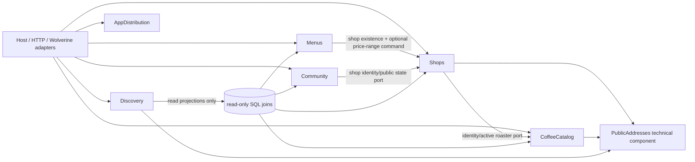

# ShopsService: карта владения данными и контрактов (P03)

Дата исследования: 8 октября 2026 года. **Статус: целевая архитектурная схема для реализации; изменения бизнес-семантики остаются предложениями из [P02](shops-architecture-decisions.md).** Это инвентаризация текущего кода и назначение одного будущего владельца записи. Папка, namespace и общий `ShopsDbContext` сами по себе не определяют владение.

Сверены 42 уникальных имени `ToTable` в [EF model snapshot](../CoffeePeek.Shops.Persistance/Migrations/ShopsDbContextModelSnapshot.cs) и три physical public-address таблицы из [миграции registry](../CoffeePeek.Shops.Persistance/Migrations/20260927112559_AddPublicAddressRegistries.cs) и [миграции audit](../CoffeePeek.Shops.Persistance/Migrations/20260928072406_AddPublicAddressAudit.cs). `ShopSchedule`/`ShopScheduleInterval` — отдельные таблицы owned-типов. Wolverine inbox/outbox и инфраструктурные таблицы не перечислены: ими владеет техническая инфраструктура, а не один из бизнес-модулей. Миграции остаются последовательными под единым владельцем `ShopsDbContextModelSnapshot`.

## Целевая зависимость модулей

Стрелка означает вызов прикладного порта или разрешённое чтение проекции, **не прямую ссылку на реализацию репозитория/запись чужой таблицы**. Для устранения циклов `Shops → CoffeeCatalog` и `Menus → Shops` интерфейсы и данные-проекции размещаются у потребителя либо в узком контрактах, а composition root связывает адаптеры. Текущий прямой доступ к одному `DbContext` — переходное состояние; architecture tests P05 должны проверять фактические операции, а не только namespace.

## Таблицы: один целевой владелец записи

| Владелец | Таблицы из EF snapshot | Право записи и замечание |
| --- | --- | --- |
| **Shops** | `Shops`, `Cities`, `CoffeeZones`, `CoffeeZoneMembershipOverrides`, `ShopSchedule`, `ShopScheduleInterval`, `ShopPhotos`, `AppliedShopChangeRequests` | Профиль, география, галерея профиля, учёт применённого изменения. `ShopPhotos` — временная физическая аномалия: её используют также посещения; см. ниже. |
| **Shops** | `BrewMethods`, `CoffeeBeans`, `EquipmentCategories`, `Equipments`, `ShopTags`, `CoffeeShopTags`, `CoffeeShopBrewMethods`, `CoffeeShopCoffeeBeans`, `CoffeeShopEquipments`, `CoffeeShopRoasters` | Справочники свойств кофейни и **назначения**. Сущность `Roaster` принадлежит CoffeeCatalog; `CoffeeShopRoasters` — Shops. `CoffeeShopEquipments` станет собственным `ShopEquipment` после P11. |
| **Menus** | `CoffeeDrinkDefinitions`, `ShopMenus`, `ShopMenuItems`, `ShopMenuPhotos`, `MenuOcrJobs` | Напитки и меню, включая ссылки на файлы Media и OCR lifecycle. `MenuOcrJobs` хранит задания OCR под тем же владельцем. |
| **Community** | `CanonicalCheckIns`, `CheckInHelpfulVotes`, `ReviewReports` | Посещения, публичность, голоса, жалобы. Фото посещения пока сохраняются в `ShopPhotos`; целевое разделение ниже. |
| **CoffeeCatalog** | `Roasters`, `RoasterPhotos`, `RoasterTags`, `RoasterTagAssignments`, `CoffeeProducts`, `CoffeeProductCountries`, `CoffeeProductSources`, `CoffeeProductPhotos`, `CoffeeVariants`, `CoffeeImportRuns`, `CoffeeFilterValues`, `Countries` | Обжарщик и его профиль, товары, предложения, импорт и классификация. Нынешний namespace `CoffeeShopAggregate.Entities.Roaster` не меняет владельца. `DiscoveryClassificationStore` пишет `CoffeeFilterValues`, поэтому это каталог, несмотря на имя. |
| **Discovery** | `DiscoveryFavorites` | Избранное пользователя. Поиск, карта, фасеты — read model; запись исходных Shops/Menus/Community/Catalog таблиц через Discovery запрещена. |
| **AppDistribution** | `AndroidReleases`, `AppDistributionSettings`, `AppDistributionAuditLogs`, `AppDownloadRedirectEvents` | Релизы, каналы, политика версий и учёт redirect. Запросы версий/настроек теперь читают default без создания строки. Redirect URL вычисляется чтением, после чего HTTP adapter отдельно отправляет команду необязательной аналитики; сбой постановки команды логируется и не отменяет redirect. Платформа должна мониторить потери этой best-effort статистики. |
| **PublicAddresses (технический компонент)** | `CoffeeShopPublicAddresses`, `RoasterPublicAddresses`, `PublicAddressAudit` | Единственный технический writer registry/history. Логическое право переименовать slug у владельца `Shops` или `CoffeeCatalog`; изменение его основной таблицы и registry — одна транзакция. Для City/Zone/Bean/Equipment/BrewMethod/ShopTag/CoffeeProduct slug живёт в owner row, отдельной registry таблицы нет. |

Это **43 + 3 = 46** актуальных физических имён таблиц в перечисленных источниках после добавления `MenuOcrJobs`. Таблица может содержать FK на другой модуль; FK не передаёт владельцу целевой таблицы право изменять чужую строку. `Shops.Location.CityId` пока не имеет FK к `Cities`; P09/29 закрывают это. `ShopMenus.CoffeeShopId`, `CanonicalCheckIns.ShopId`, `CoffeeProducts.RoasterId` — ссылки между агрегатами, а не единый агрегат. [Контекст и mapping](../CoffeePeek.Shops.Persistance/Configuration/ShopsDbContext.cs), [меню](../CoffeePeek.Shops.Persistance/Configuration/MenuConfiguration.cs), [каталог](../CoffeePeek.Shops.Persistance/Configuration/CoffeeCatalogConfiguration.cs).

### Особый случай `ShopPhotos`

Одна строковая модель [ShopPhoto](../CoffeePeek.Shops.Domain/Entities/ShopPhoto.cs) используется коллекциями `CoffeeShop.ShopPhotos` и `CheckIn.ShopPhotos`. В [DbContext](../CoffeePeek.Shops.Persistance/Configuration/ShopsDbContext.cs) check-in навигация использует `CanonicalCheckInId`; у магазина в [ShopPhotoConfiguration](../CoffeePeek.Shops.Persistance/Configuration/ShopPhotoConfiguration.cs) shadow `CoffeeShopId`. Следовательно, **сейчас два агрегата независимо пишут в одну таблицу** — целевое правило P03 ещё не выполнено. До миграции DDL и технический owner таблицы — Shops; Community имеет только явно учтённый переходный доступ к строкам `CanonicalCheckInId != null`. После P18/P29 — отдельная `CheckInPhotos` (Community), `ShopPhotos` (Shops) с backfill по FK, проверкой строк без/с двумя родителями, совместимым периодом чтения и запретом второго writer. Это миграция данных, а не механический rename. Если соседние сервисы ссылаются на photo ID, сохранить ID и проверить их контракты. Работа не считается завершённой, пока оба модуля пишут в `ShopPhotos` напрямую.

### Особый случай публичного адреса

Сейчас [PublicAddressService](../CoffeePeek.Shops.Persistance/PublicAddresses/PublicAddressService.cs) в Persistence напрямую загружает и меняет `CoffeeShop`, `Roaster`, `City`, `CoffeeZone`, `CoffeeBean`, `Equipment`, `BrewMethod`, `ShopTag`, `CoffeeProduct` в зависимости от kind. [ShopsDbContext.SaveChanges](../CoffeePeek.Shops.Persistance/Configuration/ShopsDbContext.cs) вызывает writer при публикации. Это нужная общая техническая гарантия уникальности и истории, но текущий `ChangeAsync` обходит прикладного владельца сущности. Целевой API: owner module принимает `ChangePublicAddress(kind,id,expectedRevision,slug,reason,actor)` и проверяет права/инварианты; общий технический компонент подготавливает/резервирует адрес и аудит в **той же** локальной транзакции. Сервис resolve остаётся read-port. Нельзя одновременно дать каждому модулю отдельную реализацию генерации slug или самостоятельный writer registry. Обновление этого пути — P20/P25/P27/P29, с проверкой существующих URL и revision.

## Операции записи: назначенный прикладной владелец

Имена ниже перечисляют обнаруженные команды/consumers и прямые записи в host. Физическое расположение пока не всегда совпадает с целевой границей. Перенос namespace/type Wolverine сообщений возможен только по P27 с проверкой очередей и сериализации. [Generated registry](../CoffeePeek.ShopsService/Internal/Generated/WolverineHandlers/GeneratedHandlerRegistry.cs) служит контрольным перечнем, но query с побочным эффектом и прямой host вызов также учитываются.

| Владелец | Входы/handlers текущего кода | Что записывают или координируют |
| --- | --- | --- |
| **Shops** | `CreateCity`, `UpdateCity`, `DeleteCity`; `CreateCoffeeZone`, `UpdateCoffeeZone`, `SetCoffeeZoneStatus`, `SetCoffeeZoneMembershipOverride`, `DeleteCoffeeZoneMembershipOverride` | Города, зоны, overrides; `GenerateCoffeeZoneCandidatesQuery` только вычисляет предложения. |
| **Shops** | `CreateEquipment`, `UpdateEquipment`, `DeleteEquipment`; `CreateCoffeeBean`, `UpdateCoffeeBean`, `DeleteCoffeeBean`; `CreateBrewMethod`, `UpdateBrewMethod`, `DeleteBrewMethod`; `CreateShopTag`, `UpdateShopTag`, `DeactivateShopTag`; `SetShopTags` | Справочники и назначения магазина. В текущем коде CRUD может физически удалять связанные справочники; политика P02/P09 нужна до смены поведения. |
| **Shops** | `UpdateAdminCoffeeShop`, `UpdateOwnerCoffeeShop`, `SetAdminCoffeeShopFocus`, `SetAdminCoffeeShopVisibility`, `AssignCoffeeShopOwner`, `ReorderAdminCoffeeShopPhotos`, `ReorderOwnerCoffeeShopPhotos`, `AddPublishedShopPhotos`, `RemovePublishedShopPhotos` | Профиль и галерея. Оба admin/owner входа вызывают один сценарий/инвариант Shops; исправленная защита от частичного сохранения остаётся. |
| **Shops** | `ModerationShopApproveHandler` (`ModerationShopApprovedEvent`), `ImportCandidatePublishedEventHandler`, `ImportShopEnrichmentEventHandler`, `ShopChangeRequestApprovedHandler` (`ShopChangeRequestApprovedV1`) | Приём входящего события → Shops application use case; модерация и импорт не получают независимый writer в Shops таблицы. `AppliedShopChangeRequests` принадлежит Shops. Если событие несёт меню, Shops координирует вызов Menus порта в общей транзакции. |
| **Menus** | `CreateCatalogDrink`, `UpdateCatalogDrink`; `AttachAdminShopMenuPhotos`, `ParseAdminShopMenu`, `RemoveAdminShopMenuPhotos`, `UpdateAdminShopMenu`; `ParseMenuRequestedEventHandler`, `ApplyShopMenuSnapshotEventHandler`; `ParseMenuPhotosCommand` | Определения напитков, ручное меню, OCR request/result. `ParseMenuPhotosCommand` сам по себе внешний parse/read без DB writer, но его результат влияет на Menus. `ApplyShopMenuSnapshotEvent` не должен менять Shops напрямую: applySuggestedPriceRange передаётся через порт Shops в одной транзакции. |
| **Community** | `CreateUnifiedCheckIn`, `UpdateUnifiedCheckIn`, `ChangeUnifiedCheckInVisibility`, `DeleteUnifiedCheckIn`, `SetCheckInHelpful`, `SubmitReviewReport`, `ResolveReviewReport`; `CheckInModerationDecidedEventHandler`, `UserNameChangedEventHandler` | Посещения, голоса, жалобы, публичность и имя автора; фото посещений — временное исключение `ShopPhotos` до разбиения таблицы. `CheckInCacheInvalidationRequestedHandler` — технический исполнитель post-commit эффекта Community, не writer бизнес-таблиц. |
| **CoffeeCatalog** | `CreateRoaster`, `UpdateRoaster`, `DeleteRoaster`, `ModerationRoasterApproveHandler` (`ModerationRoasterApprovedEvent`); `CreateRoasterTag`, `EditRoasterTag`, `SetRoasterTags`; `CreateCoffee`, `EditCoffee`, `ArchiveCoffee`, `ImportCoffeeSnapshot` | Профиль обжарщика, теги, товары, импорт. `CoffeeCatalogStore.ImportAsync` пока содержит бизнес-координацию и транзакцию в Persistence; P20/P21 перенесут её к владельцу. |
| **CoffeeCatalog** | `RecordCoffeeImportFailureCommand`; прямые `AdminCoffeeClassificationController → IDiscoveryClassificationStore.CreateValue/EditValue/DeactivateValue/EditClassification/EditVariantClassification` | `CoffeeImportRuns` записывается через Wolverine EF/outbox-транзакцию; ранний flush сохраняет обработку конкурентного duplicate report. Пять HTTP bypass классификации ещё требуют переноса в application commands. |
| **Discovery** | `SetDiscoveryFavoriteCommand` (PUT/DELETE) | Только `DiscoveryFavorites`; [store](../CoffeePeek.Shops.Persistance/Discovery/DiscoveryFavoritesStore.cs) выполняет flush внутри Wolverine-транзакции для обработки конкурентного idempotent PUT через EF savepoint. `DiscoveryQueryStore` и map/facets/search — read-only adapters через разрешённые joins. |
| **AppDistribution** | `UpdateGooglePlayDownload`, `UpdateAndroidApkChannel`, `UpdateAppStoreDownload`, `UpdateAppVersionPolicy`, `CreateAndroidRelease`, `PublishAndroidRelease`; `GetAppDownloadRedirectQuery`, `GetPublicAppDownloadsQuery`, `GetAppVersionQuery`, `GetAdminAppDownloadsQuery` | Settings, releases, audit и redirect events. Все четыре `Get*` вызывают `GetOrCreateSettingsAsync`; redirect ещё сохраняет event. Убрать скрытую запись из чтения или классифицировать как write use case по P26. |
| **PublicAddresses** | `AdminPublicAddressesController → IPublicAddressService.ChangeAsync/BackfillAsync`; автоматический `PublicAddressWriter` при `SaveChanges` | Техническая регистрация/аудит адресов. Инициатор бизнес-команды — модуль owner row: Shops для кофейни/города/зоны/bean/equipment/brew/shop tag, CoffeeCatalog для обжарщика/coffee product. |

Полный поиск входов: [Features](../CoffeePeek.Shops.Application/Features), [Consumers](../CoffeePeek.Shops.Infrastructure/Consumers), [Controllers](../CoffeePeek.ShopsService/Controllers). После P01/P27 эту таблицу сравнить с реально зарегистрированными Wolverine handlers и маршрутами; generated-файлы руками не править. Прочие чтения `Get*`/`Search*` опущены; `GenerateCoffeeZoneCandidatesQuery` явно не записывает.

## Узкие межмодульные порты

Имена портов ниже обозначают **ответственность**, а не требование создать классы с такими точными именами. Порт должен возвращать DTO/идентификатор/результат, а не tracked EF entity другого модуля. Потребитель не получает чужой `DbSet`.

| Потребитель → владелец | Нужный контракт | Условие |
| --- | --- | --- |
| Menus → Shops | `GetShopWriteContext(shopId, actor)` (существование/владелец/статус), `ApplySuggestedPriceRange(shopId, range, expectedRevision)` | При admin menu + price-range один координатор Menus и один transaction boundary. |
| Community → Shops | `GetVisitTarget(shopId)` (доступность и публичный идентификатор) | CheckIn хранит `ShopId`, не правит `Shops`. Удаление магазина не должно молча обойти историю посещений. |
| Shops → CoffeeCatalog | `ResolveRoasters(ids)` (существование/активность/slug); затем Shops меняет только `CoffeeShopRoasters` | Каталог не меняет назначение обжарщика кофейне. |
| Menus/Community/Discovery → CoffeeCatalog | Активные drink definitions, roaster/product/classification read DTO | `CoffeeDrinkDefinitions` остаётся Menus; каталог кофе не владеет меню. |
| Discovery → Shops/Menus/Community/CoffeeCatalog | Специализированные read projections: опубликованная кофейня, предложение меню, публичная видимость/посещение, кофе и фасеты | Read adapter вправе SQL join чужих таблиц без tracking/SaveChanges. Правило видимости принадлежит Community; Discovery использует его контрактные примеры. |
| Owner module → PublicAddresses | Reserve/prepare/commit address and audit, resolve slug | Только технический компонент пишет registry/history; owner утверждает изменение своего slug. |
| Shops/Menus/Community/CoffeeCatalog → Media | Claim/lookup/photo identity по контракту Media | Media владеет файлом; модуль владеет назначением ссылки `StorageKey/MediaPhotoId`. HTTP reservation не является частью PG transaction; retry/compensation отдельно в P17. |
| Shops/Community → Moderation | Входящее решение с `submissionId`, revision, sequence и внешним event ID | Адаптер сообщения тонкий; соответствующий модуль применяет свой агрегат и business idempotency. |

`CoffeeCatalog → Menus` не нужен для изменения coffee product; совпадение слова «кофе» не создаёт общий агрегат. `AppDistribution` не зависит от остальных бизнес-модулей. Shared libraries остаются для технических примитивов, а не для универсального доступа к Shops DB.

## Разрешённые атомарные сценарии и исключения

1. **Menus + Shops.** `UpdateAdminShopMenu` с `ApplySuggestedPriceRange=true` меняет меню и price range кофейни; Menus координирует через Shops port, один EF transaction/commit. Если запись профиля конфликтует, всё меню откатывается. OCR без явного флага не меняет price range.
2. **Shops + Menus при публикации.** Входящий moderation/import snapshot может создать кофейню и начальное меню; Shops координирует Menus port в той же транзакции либо оформляет двухэтапную durable работу с явным промежуточным статусом. Нельзя молча делать независимые commit с видимостью частично опубликованной сущности. Выбор зависит от контракта сообщения P27.
3. **Owner row + PublicAddresses.** Смена slug и регистрация/аудит выполняются атомарно. Отдельная транзакция в техническом компоненте не должна завершить внешнюю операцию преждевременно.
4. **Community + `ShopPhotos` временно.** Текущий прямой write разрешён как *зафиксированный долг*, ограниченный строками check-in. P18/P29 устраняют его разбиением; P05 не должен навечно разрешать общий `DbSet<ShopPhoto>`.
5. **Read-only joins.** Discovery и административные статистические запросы могут читать чужие таблицы с `AsNoTracking`/SQL без бизнес-мутации; список разрешённых query adapters узкий. Изменение запроса не даёт разрешение писать.
6. **Composition root.** `Host/InfrastructureExtensions` и DI видят реализации всех модулей только для регистрации. Generated Wolverine adapters являются транспортным кодом; их широкие зависимости не должны копироваться в Application.

Иных межмодульных multi-write разрешений по умолчанию нет. Новое исключение требует сценарий, координатора, owner каждой таблицы, transaction/failure tests и задачи удаления, если исключение временное.

## Размещение кода по этапам

1. **P05:** проверять запрещённые ссылки/вызовы по фактическим зависимостям. Сохранить текущие пути как baseline только с владельцем и задачей удаления: `ShopPhotos`, `PublicAddressService`, `CoffeeCatalogStore`, прямые host→store writes, `ApplyShopMenuService → Shops` и `ShopChangeRequestApprovedHandler` бизнес-координация.
2. **P06–P07:** в каждом модуле один способ выражения отказа/commit/outbox. Прямые store saves внутри контроллеров и write-side `Get*` выделить в команды, не менять API маршрут. У входящих consumers сохранить wire type и очередь.
3. **P10–P21:** укреплять агрегаты и узкие порты по владельцам. `Roaster` и его repository постепенно вынести из папки `CoffeeShopAggregate` в каталог с адаптером прежнего namespace до P27, если он участвует в сериализации; массовое перемещение не совмещать с изменением поведения.
4. **P22–P26:** специализированные DTO для read paths, явные module registration points, AppDistribution без зависимости от кофейни. Общий `ShopsDbContext` пока допустим как composition/persistence объект; интерфейс Application не должен отдавать его наружу.
5. **P27–P29:** после wire compatibility и preflight данных разделить `ShopPhotos`, добавить FK/constraints/новые таблицы, последовательно создать миграции. Успешный architecture test запрещает прежний прямой cross-module write.

## Проверка карты

P05 должен падать на искусственной записи `Discovery → db.Shops.Update`, `Menus → db.CoffeeProducts.Add`, `Community → db.ShopPhotos.Add` после разделения фото и `CoffeeCatalog → db.CoffeeShopRoasters.Add`; на разрешённых read projections и composition root — проходить. P28 повторно инвентаризирует все команды, consumers, прямые host writes, `SaveChanges`, `ExecuteSql*` и невыраженные фоновые эффекты. P34 сравнивает старые и новые HTTP/queue fixtures; изменение одного физического владельца без сохранения контрактов не считается завершением P03.
